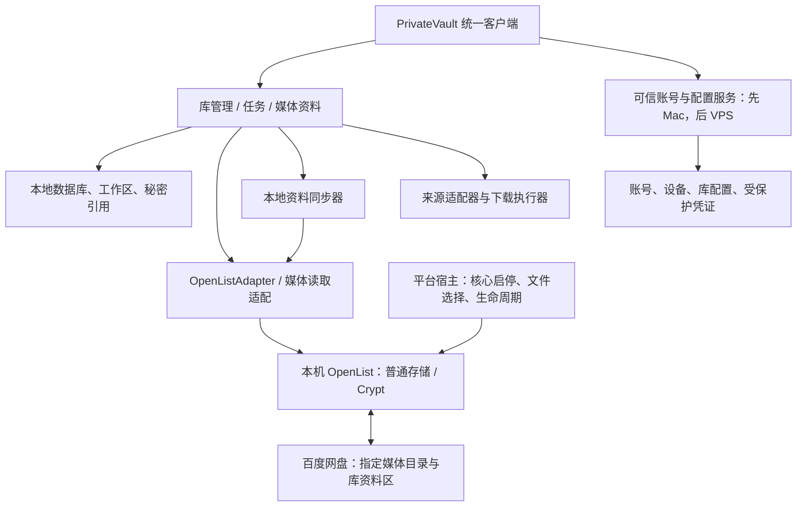

# PrivateVault 架构细化与首版边界

版本：v0.3 · 日期：2026-10-28（Asia/Shanghai）；设计决策确认：2026-10-29

状态：**A01—A07 已确认；单独获准的 W01-M 于 2026-10-30 完成实现与验收。** 保留已审阅的 [v0.2 需求](PrivateVault-需求与架构设计-v0.2.md)及 v0.1；各项确认范围见第 11 节。Mac 外壳/核心管理结果见[报告 23](docs/validation/23-W01-M执行结果-v0.1.md)；不扩大到 Android、真实账号/网盘、VPS、Git 提交或发布。

审阅建议：先看第 1、2、10、11 节；模块字段、提交协议和恢复边界详见[技术附录 20](docs/design/20-模块契约数据模型与恢复协议-v0.1.md)。

## 1. 建议收敛的方案

PrivateVault 是用户直接打开的应用。每台设备拥有自己的界面、本地任务与 OpenList；手机、Mac、Windows 各自访问百度网盘，普通库直接读写，加密库由本机 Crypt 处理。账号服务只负责账号、设备及受保护配置，不成为媒体必经的中转服务器。

| 事项 | 本稿建议 | 状态 |
|---|---|---|
| 客户端 | Flutter 共享界面及业务模型；桌面管理独立核心进程，Android 通过 Kotlin/Go 绑定承载核心 | 用户委托择优，采用此设计方向；尚未构建 |
| 存储/加密 | 固定版本 OpenList＋现成 Crypt，包在自有适配层之后 | 有 Mac/Android 样本证据支持 |
| 账号服务 | 小型 Go HTTP 服务＋SQLite；账户数据与受保护秘密分开管理 | 用户委托择优，采用此设计方向；尚未实现 |
| 元信息 | 百度库内专用资料区保存逻辑记录；本地数据库负责查询和任务，按记录同步 | 延续 v0.2，协议在附录细化 |
| 任务可靠性 | 持久阶段、每次上传独立路径、完整性验证后才提交资料 | 吸收半成品实测结果 |
| 首个工程切片 | 本地文件 → 上传 → 校验 → 提交 → 列表/详情/播放；先使用自制测试库 | 顺序建议，不等于缩减完整首版 |
| 来源 | 保留 Pixiv、hanime1；通过来源适配器接入，不宣称下载器天然支持两个来源 | 支持/授权/移动运行仍有未决项 |
| Windows | 保留接口和适配目标，暂缓实机验证 | 用户已决定，不阻塞本轮设计 |

当前不是继续反复测试 Mac 是否在线。已配置设备的媒体数据链路在本机；Mac 只有在承担账号服务或其自己的下载任务时，才需要为这些功能保持运行。

## 2. 依据与不可外推的部分

| 已有依据 | 本稿采用的结论 | 未关闭的问题 |
|---|---|---|
| Mac 普通/Crypt 完整读回、正常 Range 与播放 | OpenList/百度/Crypt 可作为底层候选 | 普通越界返回 400 而非 416、错误链接脱敏、大文件 |
| Android 图片、加密音视频及两次拖动正常的用户反馈 | 手机本地媒体执行方向可用 | 新宿主集成、后台/锁屏、严格上游流量 |
| 手机 PNG 加密上传，Mac 独立读回长度/SHA-256 一致 | 当前样本双向加解密互通 | Windows、独立 rclone、全库与长期运行 |
| 同一测试密码不匹配曾导致空列表 | 配置自检和明确错误必须进入整合层 | 输入值在哪一步改变尚未知 |
| 公开 Flutter/播放器/安全存储资料 | 可以比较宿主与组件路线 | 新客户端和插件均未安装、构建或验收 |

运行结果见[报告 18](docs/validation/18-Android加密上传与Mac独立读回结果-v0.1.md)；平台验证收尾见[决策 19](docs/research/19-平台验证收尾与后续设计边界-v0.1.md)。现成 OpenList App 跑通，不等于 PrivateVault 宿主、账号或元信息同步已经实现。

## 3. 组件分工与部署形态

- **桌面**：PrivateVault 管理自己的 OpenList 二进制、数据目录和仅本机端点；借鉴现成进程管理，但不依赖原 Desktop 安装、数据库或管理员密码。
- **Android**：自有宿主集成 Go/AAR，Kotlin 负责服务、文件句柄和系统生命周期；借鉴 Mobile 的结构，不把其内部 MethodChannel 当成其他 App 可直接调用的稳定 SDK。
- **共享层**：界面、领域模型、任务编排、元信息合并和本机接口契约尽量共用。来源执行器及系统能力可以分平台适配，不为“全共用”强行堆多套运行时。
- **账号服务**：个人实例，不默认开放注册或做多人托管。媒体读取不回流账号服务；服务停止影响新设备登录/配置恢复，以及采用中心协调策略的授权续期等具体功能。

OpenList 管理端只在适配层内部使用。原始管理员令牌不进入媒体 URL、来源网页或普通日志；纯远程 Web 页面仍不能代替设备本地核心与原生文件能力。

## 4. 技术选型比较

| 路线 | 直接收益 | 主要代价 | 本稿判断 |
|---|---|---|---|
| Flutter 自有宿主＋本机 OpenList | 三端共享 UI/业务模型，Android 已有同类桥接参考 | 桌面进程包装、Android 服务、播放器与打包仍需整合 | 优先 |
| Vue/TypeScript＋Tauri/Android WebView 宿主 | Web UI 复用，桌面有参考 | Android 壳、本机桥接、后台与桌面 Rust 边界需另做 | 保留备选 |
| 完整派生 Desktop＋Mobile | 可复用更多现有管理界面 | 两套界面技术、上游同步及许可证组合成本 | 不作为默认 |
| 独立 Web＋集中执行 | 浏览器接入容易 | 不满足已确认的三端本地执行目标 | 只可作以后可选访问模式 |

建议业务层以 Dart 为主，Go 负责现成核心及小型账号服务；Kotlin 等原生代码集中在宿主桥接。Python 仅是来源工具候选，不作为全项目必须统一的后端语言。选择依据是维护、平台集成和分发成本，不是个人熟悉程度。

账号服务只承担小规模账户、设备和配置，建议先用 Go＋SQLite，减少独立运行时/数据库服务的部署项；不预设需要 Redis、消息队列或 PostgreSQL。FastAPI 仍是成熟备选，如果后续维护成本明显更低可调整；来源下载器采用 Python 并不要求账号服务也和它耦合。这里没有承诺 Go/SQLite 的最终包必然无原生依赖，具体驱动与构建方式仍随工作包冻结。

候选组件：本地查询/任务采用 SQLite，敏感索引优先评估 SQLCipher 绑定；系统秘密存储优先评估 `flutter_secure_storage`；播放器优先评估 `media_kit`，保留外部播放器出口。官方 `video_player` 当前文档的平台表没有 Windows，不能直接视为三端统一答案。组件支持列表不是本项目运行证据，具体发行版本、原生依赖及许可证在批准后的集成工作包中冻结。

可复现的现有验证参考是 Mac 核心 v4.2.8 和用户手机 OpenList Mobile v4.2.5.26080717（150）；新 PrivateVault 宿主的核心库/Flutter/播放器组合尚未冻结。不要将这两份现成 App 的版本或 develop 分支说明直接当作新安装包已经验证的依赖清单。

## 5. 数据权威与同步

| 数据 | 权威位置 | 其他副本的意义 |
|---|---|---|
| 账号、设备、库配置版本 | 可信账号服务 | 设备缓存有效配置，支持既有使用 |
| Crypt profile 与凭证 | 受保护秘密存储；按授权策略下发 | 本机执行所需副本，不能由旧快照无条件覆盖 |
| 媒体及库资料变更 | 用户指定云端库及其专用资料区 | 本地数据库是查询投影，可重建 |
| 正在执行的任务、检查点、空间预留 | 发起设备本地数据库 | 不因配置同步而跨设备接力 |
| 普通播放缓存、临时文件 | 各设备受配额控制的工作区 | 可清理，不等同已完成离线收藏 |

加密库的逻辑资料区为 `.privatevault/`，媒体、封面、资料记录均经过同一 Crypt 视图；普通库对应内容以普通模式保存。数据库文件本身不直接跨端同步。

建议每台设备写入不可变的提交记录，携带全局操作 ID、安装实例 ID、本地序号、父版本及字段变更。读端校验记录完整性、引用资源及格式，再以本地事务应用；失败或半截提交保持待核对，不解释为空库。

字段不相交的修改可以合并；同字段并发修改保留冲突；播放列表重排首版按整列表版本冲突处理，不先承诺复杂实时协作。移除收藏形成墓碑，迟到编辑不能自动复活项目。若完整首版的多端编辑成本过高，仍可采用 v0.2 已接受的指定整理设备退路，其他设备继续上传和读取。

这里的提交记录是正常资料同步，不是额外备份；关闭可选备份不关闭正常元信息保存。初版不自动压缩或删除历史提交，后续再设计离线设备安全追赶和空间控制。

## 6. 账号、密钥与刷新凭证

### 6.1 独立账号与上游授权分开

PrivateVault 账号恢复库信息与被授权的秘密，但不等于百度/Pixiv 自动授予所有设备永久访问权。库根、Crypt 密码/salt、名称模式、编码、profile 版本作为完整一组恢复；本机虚拟挂载名只属于当前设备，不写成跨端永久定位。

**推荐模型是按设备记录上游授权绑定，能安全独立授权的提供者采用独立刷新链。** 百度是否对本项目接入方式提供真正独立的多设备刷新链尚未证实，不能把这一模型当成已具备的百度能力。新设备优先恢复库配置/密钥；上游规则要求时，允许再做一次该设备的百度授权。用户于 2026-10-29 对 A02 表示了解，提供者能力和刷新策略仍待核实。

### 6.2 不靠复制旧快照协调刷新

库配置版本与凭证版本分别管理。本机核心刷新后，适配层读取最新状态并按版本对账；冲突不能以“最后写入者覆盖”合并令牌字符串。核心自行保存的新值，不能被中心旧配置或备份覆盖。

若最终选用“共享授权域、中心统一刷新”，必须另有真正的刷新桥接/单一所有者机制。现成 OpenList 会自行刷新，仅给 PrivateVault 后台加一个锁并不能约束它；刷新桥接的认证、绕行、错误和离线语义都需要实现与验收。中心不可用且令牌到期时，这一路线可能等待授权服务，不能同时承诺无限独立续期。

因此首个工程切片只使用已授权的本机测试绑定，不提前实现或承诺跨端全自动共享百度刷新凭证。完整首版的统一账号目标保留；凭证策略是需要收敛的真实技术边界，不用当前一次互读成功代替长期轮换结论。

### 6.3 本机保护必须覆盖核心自己的数据库

系统安全存储保护 PrivateVault 自己的秘密，不自动保护 OpenList `data.db` 中的副本。现成 Crypt 保存值使用可逆混淆；本轮核对工具已能在本机还原。单独给另一个索引数据库加密，也不能据此宣称核心库密钥已获得同等保护。

**用户于 2026-10-29 确认采用实用边界 A03**：应用私有目录/权限、系统秘密存储和设备磁盘保护共同构成本机基线；加密库索引优先采用加密数据库，受控处理期间允许短期明文。明确承认 stock 核心配置在可信本机内仍可恢复秘密，不宣称本机失陷后密钥安全。受控核心秘密持久化桥接保留为未来增强路线，不能把混淆称为加密。本轮不更改现有设备设置，保护措施仍须在后续实施中落实与验收。

账号服务器仍是可信持钥方；服务器数据库中的秘密应作标准信封加密，保护密钥与业务数据库分开保管。重置账号密码不改变 Crypt 参数；撤销设备会话不能抹掉该设备已经获得的密钥或明文文件。

## 7. 元信息、对象位置与提交

现有指定目录只建立引用和必要资料，默认不搬移、改名或扫描整盘。云端专用资料区与底层密文目录从媒体扫描中排除，重叠库根默认拒绝或要求明确处理。

新归档对象使用独立 `asset_id` 和 `attempt_id` 路径，保留原始文件名；完整上传重试不覆盖上一轮半成品，也不混用不同加密随机数产生的分片。媒体未被完整验证和资料提交引用之前，不进入 PrivateVault 的已归档视图；其他网盘工具仍可能看到实际半成品，不能保证物理不可见。

提交流程为：上传对象 → 核对内容 → 本机事务准备资料/提交 outbox → 写云端不可变记录 → 读回提交并确认完整 → 本机标记已归档 → 各端拉取和建立索引。跨 SQLite 与百度没有事务，崩溃后靠固定操作 ID 和检查点对账，不假设百度有原子 rename/条件写。

来源资料与用户修改分开存。已有媒体可先取得标题、类型、大小，时长/尺寸/封面允许延迟探测；未知值显示未知，不为全库生成时长而无边界地下载所有视频。

## 8. 任务、校验与临时空间

阶段建议：接收/解析 → 下载或取得稳定本地输入 → 探测 → 上传准备 → 上传 → 验证 → 提交 → 同步/清理。阶段与运行状态分开；任务 owner 固定，用户取消、网络等待、授权等待、空间等待各有状态。

上传准备只稳定输入、计算摘要并预留空间。加密库的实际加密由 Crypt 在上传时执行一次，不能先自行加密再送进 Crypt。首版先支持阶段级恢复/完整重试，不承诺任意字节续传。

首个工程切片采用完整解密读回与 SHA-256 校验，用户已于 2026-10-29 确认 A05 及额外完整读取的带宽/耗时代价；验证强度必须显式记录。此决定只确定 E1 的基准，不触发既有全库重读。后续大文件若采用提供者哈希或较弱策略，须有能力依据和可见等级，不能把仅大小相符写成完整内容已验证；产品大文件默认策略另定。

工作区预算同时覆盖输入副本、处理输出、核心可能的完整密文暂存、播放器和第三方工具缓存。完整验证可以流式计算摘要，无需再保存一份完整明文；但不能据此断言实际峰值一定为某个固定倍数。未知大小任务逐步检查额度，空间不足进入等待。

应用登记的任务文件与核心内部缓存分别管理。活跃任务、恢复依赖及用户原始文件不能清理；未知核心缓存只在核心空闲/停止并确认边界后处理。首个切片建议单个重型归档任务，资源限额可配置，验证用的 2GiB/15GiB 不直接变成产品默认值。

## 9. 预览、来源与恢复材料

- **播放**：业务层按 asset ID 请求本机媒体读取能力；播放器拿到的是当前设备的受控内容地址，不是百度令牌、管理员 JWT 或原始密文地址。适配层统一明文长度、Range 和过期错误；普通越界 400 要转为正确的 416，并过滤上游地址。前台播放先闭环，后台音频另有 Android 生命周期方案。
- **来源**：SourceAdapter 输出作品资料及有顺序的 AssetPlan，秘密请求上下文单独保存。桌面可评估外部 gallery-dl；Android Python/Chaquopy 仍是候选，许可、运行时及原生依赖未解决前不承诺直接内嵌。hanime1 仍是明确目标，不以通用引擎支持其他站点代替其支持。
- **版权/授权**：用户登录、能打开网页与允许自动归档是不同条件。只处理用户自有或获准内容，不绕过付费、DRM 或访问限制；来源 URL、标题、文件名和外部工具输出均按不可信数据处理。
- **恢复材料**：默认只导出完整 Crypt profile、库标识/根映射、格式版本和恢复说明。用户已于 2026-10-29 确认采用标准 age 口令加密包，不自创密码学；具体库/绑定后续冻结，备份位置与独立恢复口令在实际导出时由用户确定。默认不包含来源 Cookie、百度凭证或媒体副本。元信息/媒体额外备份仍可选、默认关闭。
- **迁移**：Mac→VPS 主要迁移账号/配置服务的一致状态及受保护秘密；百度媒体不必搬家。更新服务地址/证书后小样本恢复验证，并保留受控回滚点。没有迁移执行中的设备本地任务。

## 10. 第一个开发切片与完整首版

### 10.1 第一个工程切片 E1（仅计划，未获准执行）

目标：用户从 PrivateVault 选择本地自制文件，放入指定普通/加密测试库，完成上传、完整校验、资料提交，并在自己的库列表/详情中浏览、播放；失败后重开能解释并对账。

| 工作包 | 输出 | 核心接受条件 |
|---|---|---|
| W01 自有宿主与 CoreHost | Mac 独立进程、Android 库桥接、核心版本/健康/启停接口 | 自有测试目录；重复启动、停止和启动失败可判断；不接触原 App |
| W02 库配置与本机秘密边界 | 普通/加密库模型、profile 校验、系统文件句柄 | 错误 profile 不被静默显示为空库；A03 明确前只用测试秘密 |
| W03 持久任务与配额 | 输入摘要、阶段/尝试、预留与对账 | 不能靠 100% 判成功；中断后重核验既有尝试，不覆盖原件 |
| W04 资料提交与索引 | asset/item、outbox/commit、指定目录读取 | 未验证媒体不提交；半截提交不应用；索引可重建 |
| W05 统一浏览与前台播放 | 列表、详情、图片、音视频及错误提示 | 普通/加密视图一致；实际画面定位；不泄漏上游凭证 |

E1 的手工测试配置是过渡性研发入口，不是放弃统一账号或链接归档。它是一个可运行切片，不是 v0.2 完整首版已经交付。

2026-10-29 已整理[W01 具体实施提案](docs/design/22-W01实施提案-v0.1.md)，随后用户明确批准 W01-M；2026-10-30 该 Mac 子包收尾通过。W01-A 仍在后续，Mac 子包完成不等于整个 W01 或完整首版完成。

### 10.2 完整首版仍需补齐

统一账号/设备配置恢复、可用的跨端资料同步、Pixiv 与 hanime1 单链接链路、来源授权、恢复材料导出/恢复、删除设置默认保留及必要错误恢复，仍按 v0.2 目标保留。存在来源不支持或凭证协调未决时，明确标记对应能力未完成，不静默把“仅本地上传”改称完整首版。

后台/锁屏、主动离线、自动订阅/执行设备切换按后续既定功能阶段处理。Windows 继续保留架构适配，实机验收延后；当前不宣布三端完整产品已经可用。

每个实际工作包开始前另给具体文件范围、依赖/安装项、外部操作和验收。W01-M 获准后已创建 Mac Flutter 工程与核心管理实现；Go 账号服务、业务数据库、账号/来源等仍不属于这一步。

### 10.3 可以推进与必须先解决的边界

| 后续动作 | 前置条件 |
|---|---|
| 整理 W01 的具体实施提案 | 本稿主方向经审阅；此项仍可只做设计 |
| 实际创建宿主/编写实现 | 用户明确批准该工作包及必要依赖/操作范围 |
| 在新产品启用真实库秘密 | A03 实用边界已获接受；仍需在相应工作包落实保护措施，并获准接入具体真实凭证范围 |
| 自动把百度凭证恢复到新设备 | A02 刷新所有权/提供者策略明确，不能用复制快照代替 |
| 宣称完整双来源首版可用 | 两个来源各自的允许访问方式、解析/授权、平台运行及许可组合闭合 |

未决分支不阻止先设计本地文件切片，也不被 Windows 暂缓掩盖为已解决。

## 11. 设计决策与确认状态

| ID | 建议/假设 | 本轮确认程度与影响 |
|---|---|---|
| A01 | Flutter 自有宿主＋本机 OpenList；小型 Go 账号服务＋SQLite | 2026-10-29：用户委托按项目适合程度选择，采用本稿推荐方向；不等于批准创建工程或安装依赖 |
| A02 | 新设备优先恢复库/profile；上游要求时允许一次设备授权，刷新链按提供者能力处理 | 2026-10-29：用户确认接受已说明的体验边界；百度刷新链能力与全自动凭证策略仍未解决 |
| A03 | 采用实用基线：可信本机、私有目录、系统安全存储/磁盘保护；明确 stock 核心配置仍可恢复秘密 | 2026-10-29：用户阅读解释后确认，边界见[说明 21](docs/design/21-安全边界校验与恢复材料说明-v0.1.md)；增强桥接保留为后续选项，保护措施尚未实现 |
| A04 | E1 先做本地文件闭环，账号与双来源在完整首版中继续补齐 | 2026-10-29：用户认可工程顺序；完整首版需求不变，未批准实际开发 |
| A05 | E1 默认完整读回 SHA-256；大文件验证等级/成本另定 | 2026-10-29：用户确认此阶段的完整读取、摘要比较及带宽代价；不触发全库重读 |
| A06 | 恢复材料采用标准 age 独立口令加密包 | 2026-10-29：用户确认格式与恢复边界；库/绑定后续冻结，导出位置及实际口令在使用时确定，不自动备份媒体 |
| A07 | 字段级版本/冲突保留，播放列表重排采用整表冲突；必要时退回指定整理设备 | 2026-10-29：用户认可此设计；尚未实现或运行验收 |

2026-10-29，用户在阅读 A03、A05、A06 解释后回复“那没问题了，都可以确认”。至此 A01—A07 的设计选择与说明边界完成本轮确认。提供者刷新能力、宿主集成、来源支持和具体组件版本等技术未知仍保留，不重复索要已确认的选择，也不将确认转化为追加实测或安装指令。

## 12. 证据与下一步

2026-10-30 用户确认当前协作分工：Owner 主要理解架构、判断关键决策、验收实际效果；AI 承担实现、代码检查、测试与文档维护。学习路线保留，源码统一阅读在用户确认整个项目完成后安排，不作为当前工作包继续或验收的前置条件，也不因一个阶段完成而启动源码学习。

本轮补充读取了 Flutter、播放器、安全存储及 age 的一手公开资料，并固定提交/文件摘要；清单和使用边界见[附录 20 的来源部分](docs/design/20-模块契约数据模型与恢复协议-v0.1.md)。现有平台研究、来源研究和实测结果仍保留原日期/版本，不把文档能力声明写成本项目编译或运行成功。

本稿与技术附录提供已确认的设计基线。[W01 实施提案](docs/design/22-W01实施提案-v0.1.md)中的 W01-M 已获准推进，实际完成与未验证项见[阶段结果 23](docs/validation/23-W01-M执行结果-v0.1.md)。剩余技术未知按工作包取得证据，不将 Mac 独立检查外推成三端完整产品已可用。

2026-10-30 下一步已形成[W01-A 具体实施提案](docs/design/24-W01-A实施提案-v0.1.md)：维持先完成自有 Android 宿主、再进入 W02 的顺序。Go/gomobile、SDK/NDK、构建版本和文件/权限范围已列为候选，研发待明确批准；手机安装与实机验收等 APK 成形后再具体确认。当前没有安装工具链、生成 Android 代码或连接手机。
