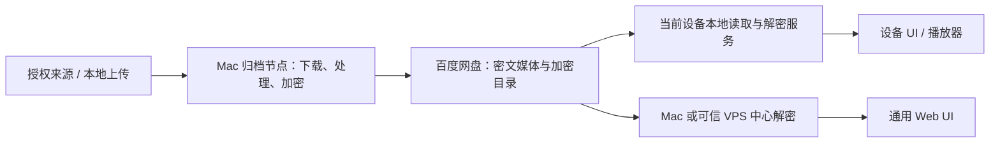

# PrivateVault 需求规格与架构设计

版本：v0.1 · 日期：2026-10-13（Asia/Shanghai） · 状态：**供用户审阅，未批准实施**

## 0. 文档边界与结论

本阶段仅研究公开资料、核对需求、制定架构与验收计划。本文的模块、接口、数据结构和状态机均为设计，不是实现。未安装软件、未部署服务、未连接用户百度网盘、未进行上传或播放实测、未修改项目仓库。用户确认设计之前，不进入实施阶段。

**建议采用“单一归档写入节点＋可独立播放的设备端服务＋加密目录清单”的渐进架构。** 初期 Mac 是归档和媒体库管理主节点；Windows、Android 经验证后各自直接读取百度网盘密文并本地解密。集中式播放作为较易实现的首个验证链路及备用模式。独立播放是重要目标，Android 实测是阻断性门槛，不能用集中式成功代替。

Mac 睡眠时，Mac 上的下载、订阅、加密、上传和中心 API 不继续执行；设备端独立播放只有在本地服务、云端凭证、解密配置和媒体目录均可用时才成立。未来 VPS 可以接替归档节点，但若它保存 Crypt 密钥，它就是可接触明文的可信节点，不属于“云服务器无法解密”的端到端架构。

证据标签：**[用户需求]** 为本次明确要求；**[文档确认]** 为官方资料声明；**[设计建议]** 为本文决策；**[待实测]** 为尚无端到端证据；**[待确认 Hxx]** 为须由用户确认的假设。文档确认不能升级为实际验收通过。

## 1. 需求范围与优先级

### 1.1 已确定范围

- [用户需求] 单人私人媒体收藏，已有百度网盘 6TB SVIP；图片、视频、音频及 ASMR。
- [用户需求] 仅 macOS、Windows、Android；初期 Mac 本地验证，未来可迁移 VPS；实用性优先于语言熟悉度。
- [用户需求] 粘贴来源链接后后台下载、处理、加密上传；也能上传本地文件。
- [用户需求] 作者、封面、标签、来源、播放列表；合法账户授权；订阅及增量归档；队列、日志、缓存和临时空间管理；在线浏览及播放。
- [用户需求] 比较中心解密与设备独立解密；严格区分 Web UI 和本地解密能力；关注 Mac 睡眠、Android、视频 Range。

### 1.2 可追踪功能清单

P0 为可行性与可靠性门槛，P1 为首版可用闭环，P2 为扩展体验。独立播放验证不得因排到后续里程碑而视为可选。

| ID | 优先级 | 功能 | 完成标准 |
|---|---|---|---|
| F01 | P0 | 百度授权、密文读写、Crypt 互读 | 三平台验证记录；云端不出现测试媒体明文 |
| F02 | P0 | Range、拖动、Mac 离线独立播放 | 满足第 4 节测试矩阵；失败明确降级 |
| F03 | P0 | 配额、检查点、恢复和归档提交 | 故障注入不误报成功、不误清理原件 |
| F04 | P0 | 密钥备份、凭证保护、私有访问 | 恢复演练通过，日志与导出无凭证 |
| F05 | P1 | 本地上传 | 分段接收、校验、加密、上传、可播放闭环 |
| F06 | P1 | 首批授权来源链接归档 | 先支持用户指定的 1 个图片源和 1 个音视频源；有明确支持矩阵 |
| F07 | P1 | 媒体库、搜索、作者、标签、封面 | 缺失字段可手填；来源字段保留溯源 |
| F08 | P1 | 图片浏览、视频/音频播放、播放列表 | 原件保留；不支持的编码明确提示外部播放器或衍生版 |
| F09 | P1 | 任务队列、取消、重试、日志 | 显示阶段、字节、错误与可恢复性；暂停语义真实 |
| F10 | P1 | 多端只读目录同步 | Mac 睡眠后可浏览最后成功发布的库；显示同步时间 |
| F11 | P2 | 订阅、增量归档 | 稳定来源 ID 去重；失败不推进成功归档游标 |
| F12 | P2 | 播放进度、标签修改跨端同步 | 离线事件合并和冲突提示；不复制正在使用的数据库 |
| F13 | P2 | 转码、后台连续播放、离线缓存 | Android 锁屏和省电实测；配额与隐私可控 |
| F14 | P2 | VPS 迁移与第二存储提供者 | 单一写节点切换、恢复、校验与回滚通过 |

不纳入首版：多人分享、公网匿名链接、DRM 绕过、全网站通用下载、自动破解登录、iOS、分布式多主写入、自研加密算法、6TB 全库预转码。

## 2. 非功能要求

下列数值均是 **[待确认 H06] 的验收目标，不是已证明性能**。

| 项目 | 设计目标及边界 |
|---|---|
| 可用性 | Mac 在线时可提交任务；离线时客户端明确显示不可用。独立播放不依赖 Mac IP/API/代理。云服务故障不承诺可播放 |
| 性能 | 1 万媒体条目下本地索引列表/检索 p95 ≤1 秒；基准环境另行记录 |
| 播放 | 冷启动 ≤10 秒，10%/50%/90% 拖动恢复 ≤5 秒，连续播放 30 分钟；有效下载吞吐建议 ≥媒体码率 1.5 倍；网络不足应缓冲而非误称解密故障 |
| 内存/磁盘 | 文件处理以流和磁盘为主，不能将整个视频读入内存；配额覆盖所有工具及播放器缓存 |
| 完整性 | 入库前至少核验远端对象、长度及可解密性；各验证级别独立记录，不能把存在性当作完整校验 |
| 可恢复性 | 阶段检查点持久化；唤醒/重启后对账再恢复；不能保证任何来源或上传会话都支持字节续传 |
| 隐私 | 原件、封面、衍生文件和同步清单在云端均加密；本机明文索引/缓存受设备保护 |
| 可维护性 | 模块化单体；工具与适配器可替换；锁定验收版本；升级先做小样本回归 |
| 备份 | 建议元数据 RPO ≤24 小时、元数据与配置恢复 RTO ≤2 小时；全量 6TB 恢复取决于带宽，不包含在该 RTO 中 |
| 成本 | 无额外云存储的初期路线；VPS、流量、第二备份盘和转码资源预算另行批准 |

## 3. 官方资料核查与证据限制

核查日期为 2026-10-13。部分旧文档域名发生跳转或读取失败，采用能读取的项目 README 和文档；链接后续可能变动。没有执行运行验证，也没有审计整个上游代码库。

| 核查项 | 可确认内容 | 不能据此确认 |
|---|---|---|
| OpenList Crypt | 文档声明兼容 rclone Crypt；文件名编码默认 base64；不同加密参数需一致 [S1] | 所有版本、所有百度 API、Android 播放器都已兼容 |
| rclone Crypt | 加密层包装底层 remote；同参数可异机访问；配置中的 obscure 不是安全存储；换内容密钥需重新加密 [S2] | 百度网盘是官方原生后端；无需本地服务即可浏览 |
| rclone 后端 | 当前官方后端列表未列出 Baidu [S3] | 所有第三方百度工具都不可用；但不能推荐“rclone 直接原生挂百度”作为已支持路线 |
| Desktop | README 列 macOS/Windows，管理本地 OpenList 与 rclone；同时提示早期开发稳定性风险 [S4] | 集成了 PrivateVault 媒体库；没有额外依赖；实际系统版本已满足 |
| Mobile | 官方 README 将其定义为基于 OpenList 的移动文件服务器，支持 Android [S5] | 锁屏存活、Crypt 可配置、Range 稳定、音频连续播放已验收 |
| 百度驱动 | OpenList 文档描述授权、下载请求头和上传分片约束 [S6] | 用户账户的权限、限速、文件上限、Range、VPS 异地登录当前实际行为 |
| 下载工具 | yt-dlp 面向音视频，gallery-dl 面向图片集合；支持站点及认证取决于工具与站点 [S7][S8] | “p 站”的具体含义；任何收藏列表都能合法完整抓取 |
| rclone 跨平台 | 官方安装文档覆盖 macOS/Windows；挂载存在额外依赖 [S9] | Android 成熟 GUI、挂载或后台服务可直接满足需求 |

重要修正：**相同 Crypt 参数提供解密兼容的必要条件，但不是完整可用系统的充分条件。** 设备还需要独立存储授权、支持相关驱动的本地进程、可用的读取/Range 链路以及本地目录。OpenList 和 rclone 配置格式不能直接互换；不要整份复制含管理员密码与刷新令牌的服务器数据库。[S1][S2]

百度 API 的第一方文档入口本次读取失败，未独立确认最新会员文件大小、分片时限及授权范围。OpenList 文档中的规则仅作为验证线索，不能承诺 SVIP 会消除所有接口限制。[S6][S10]

## 4. 核心场景与可行性验收

本节是用户批准设计后的测试计划，**当前所有运行验收均为未执行**。使用用户自制或授权样本；记录 OS、设备架构、手机型号、省电设置、工具/内核版本、加密参数标识、样本编码/大小、网络条件及结果，不记录密钥。

| 测试 | 步骤与验收条件 | 失败后的决策 |
|---|---|---|
| T01 基础存储 | Mac 授权；传小图、音频、>20MB 视频及代表性大视频密文；列举、读回、比较明文哈希 | 百度链路失败则暂停依赖它的实现；核对官方授权/限制 |
| T02 Crypt 互读 | 同一云端测试目录，rclone 与 OpenList 交叉读写；中文、长名、空文件、边界块、目录、不同大小；读回 SHA-256 相同 | 锁定一种已验证参数/引擎，不能宣称全面互通 |
| T03 Windows 独立 | 断开 Mac 网络/让 Mac 真实休眠；Windows 本地服务读取云端图/音/视频、拖动 | 若只是连接 Mac 的 WebDAV，判定失败 |
| T04 Android 独立 | 手机独立网络，Mac 休眠；检查本地核心及驱动，图片预览、视频拖动、音频锁屏 30 分钟 | UI 打开或 APK 存在不算通过；验证外部播放器或备用方案 |
| T05 Range | 冷缓存请求首段、中段、尾段、后缀范围；验证 206/Content-Range/明文总长，非法范围 416；跨加密块读取与本地原件逐字节比较 | 若只返回 200 全量下载，不算随机读取通过 |
| T06 真正快进 | 大文件冷缓存拖到 90%，查看传输量和耗时；不能为每次拖动先下载整个前缀；重复拖动无花屏/错误 | 优先定位底层 Range、URL 过期、代理、容器索引和编码 |
| T07 可播放格式 | MP4 H.264/AAC、WebM/其他实际收藏格式、MP3/FLAC、JPEG/PNG/WebP；分别测试浏览器与播放器 | 不支持格式走外部播放器或预生成衍生版；不能混同加密失败 |
| T08 中断恢复 | 下载/处理/上传/提交各阶段睡眠、杀进程、网络断开；唤醒后无重复可见条目、不误删未归档数据 | 不支持续传可重启当前阶段；界面如实显示 |
| T09 配额清理 | 小配额、未知大小、处理中磁盘不足、上传失败、缓存占满 | 进入 WAITING_SPACE；活动文件不被清理，无越界删除 |
| T10 元数据离线 | 发布目录后让 Mac 休眠，手机浏览作者/标签/封面；显示目录版本 | 只看文件名不算 PrivateVault 元数据同步通过 |
| T11 凭证/完整性 | 令牌过期、密钥错误、密文损坏、URL 泄露检查、旧目录回退 | 等待授权/阻断读取，不吞掉错误，不记录令牌 |
| T12 备份恢复 | 独立环境恢复密钥、目录、数据库及样本；读取并校验 | 未通过不得大规模导入 |

用户场景验收：

- **粘贴授权链接**：先识别来源并显示授权要求、资源数/未知、质量及预计空间；确认后逐项归档。部分失败保留成功项和错误，不把合集标为全成功。
- **本地上传**：三端均可向在线节点提交；断线可查询接收进度，未完成文件不可见为已归档。本地原文件默认不删除。Android 大文件后台上传另测。
- **Mac 睡眠后播放**：Windows/Android 本地运行读取链路；不联系 Mac；最后已同步的媒体库可用。没有云网络时只能播明确缓存完整的文件。
- **订阅**：新增项归档一次；删除的来源项不自动删除私人收藏；源授权失效停止该源并通知；睡眠错过的轮询合并补查一次。
- **失败与取消**：操作返回可观察状态，重试不会重复创建媒体；取消终止子进程并对账已上传对象，按策略清理。

## 5. 候选架构与推荐决策

### A. 集中式服务端解密

浏览器/播放器 → HTTPS PrivateVault → 中心 OpenList Crypt 或 rclone 解密 → 百度网盘密文。

优点：统一 API、元数据和凭证管理，客户端配置少，较适合第一条可用链路。缺点：中心节点持密钥并传输明文；Mac 休眠即中断；VPS 需承担媒体下行带宽及信任。适用：Mac 在线或以后愿意信任常开 VPS 的便捷模式。

### B. 每设备本地服务独立解密

每设备 UI/播放器 → 本机 OpenList 百度驱动＋Crypt → 百度网盘密文。设备各自持解密参数及百度授权。Mac 只负责归档写入，不参与其他设备播放。

优点：Mac 休眠不影响其他已配置设备；视频不经过 Mac/VPS。缺点：设备配置、密钥暴露面、Android 生命周期和多端目录同步增加复杂度。OpenList 自带 UI 不等于 PrivateVault UI。

**两种实现候选，不可叠加误用：**

1. OpenList 同时负责百度访问和 Crypt；PrivateVault 从解密挂载读取明文。
2. OpenList 只暴露百度密文 WebDAV，rclone Crypt 包装它；读取由 rclone 负责。每台设备须有自己的 OpenList，不能仍指向 Mac。多一层协议，不保证续传/校验/Range。

每条链路只能有一个预期的内容加密层；向 OpenList Crypt 再上传已被 rclone 加密的文件会形成非预期双重加密。

### C. 浏览器端直接解密

浏览器持 Crypt 密钥，直接读云端密文并实现随机块解密及媒体流。优点是减少本地守护进程；缺点是云端 CORS/请求头、授权、Range、格式兼容、内存和移动后台限制，以及自研 Crypt 兼容代码成本。**不推荐首版**；不把 PWA 安装等同于解决这些问题。

### D. 备用架构

- 常开可信 VPS 解密：降低 Android 本地服务需求，但改变密钥信任与费用，必须重新确认。
- 无密钥常开网关＋设备解密：网关只处理百度访问和密文 Range；减轻设备百度驱动负担，但仍依赖网关、需端侧 Crypt 和凭证边界验证。
- 下载完整密文后本地解密播放：可作为离线降级，不能声称满足在线随机快进。
- 更换/增加标准 WebDAV 或 S3 存储：生态可能更简单，但不替代现有 6TB 的经济价值，须算容量和费用再决定。

### 推荐 ADR（均待批准）

上图两条播放路径是可选模式。Mac 睡眠时中心路径停止，设备本地路径是否可用由 T03/T04/T05 决定。

| 决策 | 理由 | 重审条件 |
|---|---|---|
| ADR01 模块化单体＋单归档写节点 | 个人规模无需分布式队列；降低恢复与维护成本 | 多节点持续任务需求 |
| ADR02 优先验证 OpenList 百度＋Crypt | 用现有驱动和格式，不自研密码学 | Range/互读/授权失败 |
| ADR03 保留 rclone Crypt 包装密文 WebDAV 候选 | 独立格式工具与迁移出口 | 协议或 Android 成本过高 |
| ADR04 主目录只由归档节点发布；设备只读 | 避免云盘缺少事务导致多主覆盖 | 用户坚持所有端离线编辑全部元数据 |
| ADR05 Web 负责管理；本地服务负责独立播放 | 分清访问界面与执行能力 | 原生端需求明确且现有服务不足 |
| ADR06 原件不可变，衍生版独立加密 | 保留收藏原貌，便于重试和校验 | 预算/磁盘约束调整 |

## 6. 模块与接口契约（逻辑设计）

| 模块 | 职责 | 输入/输出与约束 |
|---|---|---|
| Identity / Device | 单用户认证、设备登记、权限 | 设备令牌可撤销；本地读服务不默认暴露局域网 |
| Catalog | 作者/标签/媒体/列表/查询 | 写入带 revision；来源原值和手动覆盖分开保存 |
| SourceAdapter | 解析链接、列集合、下载、增量发现 | 返回稳定 source_id、授权需求、预计大小、支持能力；不返回日志中的秘密 |
| Scheduler / Worker | 租约、队列、检查点、子进程 | 认领必须原子；过期租约对账后重领；任务不在 Web 请求中长时运行 |
| Processor | 探测、缩略图、可选转码 | 固定预设、CPU/空间限额、未知文件隔离；原件不可覆盖 |
| StorageProvider | 底层密文对象操作 | stat/list/read_range/upload/query_upload/delete；每项可声明不支持 |
| CryptoAccess | 固定 Crypt profile 下的读写 | PlainAsset 与 CipherObject 的类型/路径明确分离，防绕过或双加密 |
| MediaGateway | 明文 HTTP Range、授权、会话 | asset_id/variant/range → 206/416；短期播放会话不包含云端刷新令牌 |
| WorkspaceManager | 临时目录、预留空间、LRU 清理 | 所有外部工具 temp/cache 路径受控；活动文件有租约保护 |
| Sync / Backup | 不可变目录快照、事件同步、恢复 | 发布版本、父版本、哈希、schema；导入不得接纳任意路径 |

建议 PrivateVault API 资源：

| 资源 | 操作语义 |
|---|---|
| `/api/v1/imports` | 添加链接；idempotency_key；返回 job_id，不同步等待完成 |
| `/api/v1/uploads` | 创建接收会话、查询分段、接收分段、finalize；校验总长/哈希/配额 |
| `/api/v1/jobs/{id}` | 状态、阶段进度、错误；pause/resume/retry/cancel，状态不允许时返回冲突 |
| `/api/v1/media` | 游标列表、筛选；元数据修改需要 expected_revision |
| `/api/v1/playback-sessions` | 返回当前访问模式和受控播放地址、期限；本地地址仅用于本机上下文 |
| `/api/v1/media/{id}/content` | 授权后 GET/HEAD；明文语义 Range；不把上游密文 Content-Length 透传 |
| `/api/v1/subscriptions` | 支持源、轮询频率、游标和最近错误；停用不删除归档 |
| `/api/v1/sync` | 目录版本与设备事件上传；设备凭证不能任意覆写主目录 |
| `/api/v1/events` | SSE 任务进度；断线后用事件游标或重新查询恢复 |

这些是 PrivateVault 自有 API 建议，**不是 OpenList 现成 API 的准确路径**。OpenList 鉴权、上传方法、WebDAV 行为需在验证阶段适配。统一错误包括 AUTH_REQUIRED、UNSUPPORTED_SOURCE、WAITING_SPACE、RATE_LIMITED、INTEGRITY_FAILED、CAPABILITY_MISSING、REVISION_CONFLICT；秘密不得进入响应。

## 7. 数据模型与云端布局

初期建议 SQLite 保存业务元数据与任务；秘密保存在独立凭证库；云端保存密文对象和加密快照。多端不能把活跃 SQLite 文件直接同步成共享数据库。

| 实体 | 核心字段与关系 |
|---|---|
| Vault | vault_id、schema_version、active_profile_id、catalog_revision |
| CryptoProfile | profile_id、算法/格式版本、文件名模式、目录模式、编码、根路径映射；仅密钥引用，不存明文密码 |
| Provider | provider_id、类型、root、credential_ref、capabilities、最近探测；6TB 是账户容量背景，不是空闲容量保证 |
| MediaItem | media_id、type、title、author_id、状态、created_at、revision、source_ref；一个作品可有多个 Asset |
| Asset | asset_id、media_id、role(original/cover/thumbnail/playback)、mime、codec、duration、尺寸、plaintext_size、私有 SHA-256 |
| StoredObject | object_id、asset_id、provider_id、profile_id、逻辑路径、密文定位、cipher_size、验证级别、状态；一个 Asset 可多副本 |
| Author / Tag | 独立 ID、名称、来源标识；MediaTag 连接表 |
| SourceRecord | adapter、canonical_url、external_id、源版本、抓取时间、授权声明引用、原始元数据；禁止存 Cookie |
| Playlist / PlaylistEntry | playlist_id、title、revision；entry_id、media_id、rank，可保留同一媒体多次出现 |
| Subscription | source、credential_ref、poll_interval、discovery_cursor、last_success、状态；发现与归档完成分别记录 |
| Job / JobAttempt | job_id、parent_id、阶段、状态、租约、重试次数、next_run_at、幂等键、检查点、error_code |
| WorkspaceFile | job_id、role、path、size、lease、expires_at、verification_status |
| Device / PlaybackEvent | device_id、撤销时间；event_id、media_id、position、completed、逻辑计数、客户端时间、服务端时间 |
| CatalogSnapshot / Backup | revision、parent、schema、对象哈希、发布时间、验证结果、备份目标 |

约束：`adapter + external_id + version + quality` 用于来源幂等；实际文件哈希可发现重复但不能自动合并不同作品的来源/标签。Job 幂等键唯一；同一原件默认不可变；删除用 tombstone，延迟清理副本；关联封面不能自动下载任意未授权 URL。

建议逻辑布局（展示解密后的路径，实际云端名称经 Crypt 转换）：

- `objects/<asset-id>/original` 与 `variants/<asset-id>/<variant-id>`；避免以作品长标题组成路径。
- `catalog/<revision>/manifest`：版本化加密清单，包含对象索引、元数据和封面引用。
- `catalog/<revision>/complete`：快照完成记录；包含父版本和内容摘要。
- `events/<device-id>/<event-id>`：后期设备追加事件。
- `staging/<job-id>/<attempt-id>`：未完成归档，禁止正常浏览。

发布不能假定百度提供原子 rename 或 compare-and-swap：先上传所有对象并验证，再发布不可变清单，最后发布完成记录。客户端只接受所有依赖齐全的完整快照；`latest` 只是可重建提示。无强一致列举时允许看到旧快照，不允许看到半个新库。单写节点避免争抢同一版本。

设备保存最高已接受 revision 与父版本链，遇到更旧目录提示而非静默覆盖。Crypt 内容认证不提供目录新鲜度或发布者身份；若防恶意云端回滚/已持钥设备伪造目录成为硬要求，需增加主节点签名及设备信任公钥。新设备在没有外部可信版本锚点时不能仅凭云端判断最新版本，列为额外设计门槛。

## 8. 下载、处理、加密、上传与预览链路

### 8.1 授权来源链接

链接验证 → 来源/账户权限检查 → 解析作品或集合 → 预留空间 → 下载到专用临时目录 → 完整性检查/媒体探测 → 提取作者等信息及生成封面 → 固定 Crypt profile 加密 → 上传不可见候选对象 → 远端验证 → 数据库提交 READY → 发布加密目录快照 → 清理任务临时明文。

大集合使用父任务＋单项子任务；逐项入库。源站返回的元数据是来源声明，不是事实校验结果；保留抓取时间。下载质量、字幕、封面、列表展开上限由预设决定，不执行用户输入的任意工具参数。

### 8.2 本地上传

浏览器分段上传 → 在线 Mac/VPS 接收并保留 session 检查点 → 校验总长和哈希 → 合流到上述处理链。Android/Windows 浏览器不会因此自动拥有独立上传工作节点。Mac 离线时提交暂不可用；离线保存意图属于后期本地客户端能力，不能依靠后台 PWA 保证。

### 8.3 加密策略候选

- **流式加密上传**：节省一份完整密文暂存，但底层接口若需要预计算分片哈希、随机读或重试，工具可能仍落盘；必须测实际空间峰值和恢复。
- **先生成稳定密文再上传**：更容易固定上传重试内容和分片检查点，空间占用增加。建议首个可靠闭环优先验证此方式；若跨端互读不通过则回到 OpenList Crypt 直接写入方式并重估暂存。

不能假定“rclone 上传＝零临时文件”。同一上传尝试需复用同一份密文；重新加密会改变随机 nonce，不应在旧上传会话里混用新分片。修改 Crypt profile 不能当作普通重试。[S2]

### 8.4 预览与播放

- 图片：读取已加密缩略图/封面 → 访问节点解密 → 浏览器；放大时读取原图。云端不能存明文封面作为隐私捷径。
- 视频/音频：播放器发明文 Range → 解密节点映射所需加密块 → 底层云端范围读取 → 认证解密 → 返回对应明文字节。优先使用上游引擎处理映射，不自研。
- 集中式解密节点在 Mac/VPS；独立模式解密节点在当前设备；不能把云端密文 URL 发给普通播放器就期待自动解密。
- 容器索引与编码是独立因素：MP4 可选生成 faststart 衍生版；其他格式可使用外部播放器。HLS/转码作为 P2，衍生分片及索引同样加密；独立设备不应依赖 Mac 临时实时转码。
- 远端 URL 过期时重新解析并重发当前 Range；最多有限重试。拒绝将凭证嵌入长期 URL；访问层缓存和播放器缓冲均计入配额。

## 9. 任务状态机、恢复与幂等

将**阶段**与**执行状态**分开，避免把等待授权当作下载阶段结束。

阶段：RECEIVE/RESOLVE → DOWNLOAD → INSPECT → PROCESS → ENCRYPT → UPLOAD → VERIFY → COMMIT → PUBLISH → CLEANUP。

状态：QUEUED → RUNNING → SUCCEEDED；RUNNING 可转 WAITING_SPACE、WAITING_AUTH、RETRY_WAIT、PAUSING、CANCELLING 或 FAILED。PAUSING 在实际检查点后变 PAUSED；CANCELLING 在子进程停止和对账后变 CANCELLED。未知挂起进程重启后进入 RECOVERING，不直接改成功。

| 事件 | 持久化与恢复规则 |
|---|---|
| 下载中断 | 保存来源稳定 ID、etag/last-modified、已下载字节；上游版本变化则隔离旧文件并重下，不拼接不同版本 |
| 处理/加密中断 | 删除或隔离未完成输出；从已校验原件重新执行；不把 partial 当作可上传对象 |
| 上传中断 | 保存稳定密文、upload_id、分片确认；查询会话是否有效。无恢复能力就重传当前对象 |
| 上传成功但 DB 未提交 | 查远端候选对象与任务清单，对账后提交或隔离；不要直接再生成同名新媒体 |
| DB 提交但目录发布失败 | 媒体在中心可用，跨端标记“待同步”；重试发布，不能误称已同步 |
| 清理失败 | 数据已归档仍可成功，但 workspace_cleanup_pending 单独显示和重试 |
| Mac 睡眠/重启 | 子进程可能挂起或退出，网络会话可能过期；唤醒后等待网络、更新租约、对账、再续传/重试 |
| 手动取消 | 撤销待执行步骤、停止子进程；清理本任务独占候选对象，禁止删除已有共享归档 |

网络/5xx 采用指数退避＋随机抖动，建议上限 5 次/阶段；429 尊重 Retry-After；授权错误等待用户重新授权；权限拒绝/不支持源/损坏密文不无限重试。数值待确认。暂停为“停止在可安全恢复点”；不能支持字节续传时告知重启该阶段。

任务结果区分 archived、catalog_synced、verified_level、cleanup_done。完整恢复可能需要原始明文和稳定密文同时保留，空间不足时暂停，不通过提前删除未验证文件解围。

## 10. 临时空间、缓存与清理

[待确认 H05] 建议 Mac 任务工作区 40GiB、播放缓存 5GiB、最低系统空闲 15GiB；Android 播放缓存 2GiB；并发下载 2、上传 1、转码 1。这些只是小规模起点，大视频必须先按公式核对。

空间预估：**原始下载 S＋处理衍生 D＋稳定密文 E＋工具额外暂存 U＋安全余量 M**。流水方式可降低峰值，但要用实际工具验证；预留总额再按实时占用修正，未知长度设置硬上限并随流增长检查。单文件超配额则提示提高配额/换工作盘/改策略，不偷偷写到系统其他目录。

目录区分接收、原件、处理中、密文待上传、播放缓存和隔离失败件；名称用任务 ID，文件权限限制当前用户。所有下载器、FFmpeg、OpenList、rclone、浏览器/原生播放器的缓存都要纳入调查；第三方播放器不可控缓存明确显示限制。

清理顺序：过期无租约缓存 → 已完成且验证通过的工作文件 → 过期取消任务 → 用户批准清理的失败件。默认失败件保留 72 小时、日志 30 天，待确认。清理仅处理工作区登记文件，禁止跟随符号链接越界；运行中及上传恢复依赖文件禁止 LRU 删除。

SSD 上删除文件不保证不可恢复；建议工作区所在设备启用磁盘加密，不承诺覆盖写“安全擦除”。云端归档删除是另一个显式操作；自动空间清理不能删除收藏原件。本地源文件默认始终保留。

## 11. 密钥、凭证、安全与授权边界

### 11.1 信任与密钥

云存储仅保存密文，但仍可观察大小、目录形状、访问时间等信息。Crypt 不掩盖所有元信息。[S2] 解密设备及执行下载处理的节点可信；在这些节点上的恶意软件或管理员仍可读取明文。

Crypt profile 冻结密码、password2/salt、内容加密开关、文件名/目录模式、编码和根路径映射。建议 standard 文件名加密、目录加密、内容加密始终启用；base64/base32 暂不拍板：需覆盖 Windows/macOS 大小写不敏感本地暂存及 OpenList 提示的兼容风险。[S1] 本地密文若采用 base64 路径，需避免大小写冲突，可能改用区分大小写工作卷或选择已验证参数。

优先使用 macOS Keychain、Windows 系统凭证保护、Android Keystore 封装本地秘密；现成 OpenList 客户端是否具备这些能力待查证，不能因设计建议就宣称上游已提供。无法安全持久化时采用受设备磁盘保护的配置、手动解锁或更换客户端，并把后台自动运行取舍交用户决定。

设备配置包只包含必要存储与 Crypt 参数，需加密传输/离线导入；不能经聊天、日志、剪贴板同步或公共仓库传播。百度刷新令牌、来源 Cookie、PrivateVault 会话和 Crypt 密钥分别管理。rclone 的 obscure 不能作为凭证加密。[S2]

备份密码和自定义 salt 至独立密码管理器及离线恢复介质；媒体备份、密钥备份不得只有同一故障域。撤销设备 API 令牌不撤销它已经拥有的 Crypt 密钥：设备失陷需要云凭证撤销及密钥轮换，新目录重新加密并验证后才能删除旧副本。[S2]

无人值守 Mac/VPS 需要进程可取得密钥；手动解锁模式锁定时不能继续加密归档。VPS 若持密钥，需要信任其管理员和宿主环境；“只存密文”的 VPS 可提供目录/密文中转，但不能承担需要明文的下载处理或转码。

### 11.2 服务和下载安全

- 初期监听回环地址；远程访问建议私有网络或经审阅的 HTTPS 方案；实际部署另行批准。避免直接公网暴露 OpenList 管理端。
- 本地服务需要设备认证、Origin/Host 校验，防止恶意网页调用 localhost；统一 Web 页面访问本地服务还涉及 CORS、混合内容及浏览器权限，首版优先从设备本地服务打开 UI，不保证中心网页可无缝连接本地端口。
- 链接只接受批准适配器和 HTTPS 域名；逐次重定向/DNS 校验，防 SSRF 到内网、回环、云元数据地址。不给下载工具任意执行参数。
- 外部工具以参数数组调用、限权运行；下载文件名与压缩包路径不可越界；媒体探测/转码设时限、CPU/内存限制。
- 不调用百度在线解码/转码处理 Crypt 密文；TLS 保护传输，明文响应建议 no-store，禁止公共代理缓存。
- 日志只记录任务 ID、阶段、错误码、字节和脱敏源标识；Cookie、token、带签名 URL、完整来源 URL 查询参数及密钥映射默认隐藏。

### 11.3 版权与来源授权

收藏不等于具有复制、自动下载或分享授权。仅处理用户自有、明确许可或在适用规则下获准归档的内容；登录账户仅证明访问授权，不自动证明归档权利。首批源需记录站点、内容类型、下载工具、认证方式、许可/用途及限频；遇到 DRM、付费访问绕过或平台明确不允许的自动化路径，停止并提示。

不使用破解接口作为可靠架构基础；百度授权优先用户自有获准应用或用户审阅的官方流程。OpenList 在线授权中介涉及第三方信任，应明确凭证流向和作用，不能默认为无风险。[S6] 本文不对具体站点使用条款作法律结论；选定来源后重新核查。默认禁用分享与公开链接。

## 12. 跨端媒体目录与播放进度

**Crypt 解决文件读取，Catalog Sync 解决整理资料，两者独立。** [设计建议] Mac 单主编辑标题、作者、标签和列表；每次批量提交生成不可变加密快照，设备解密并更新本地可查询索引。封面也是加密 Asset；云端不单独泄露作者/标题。

Mac 睡眠时已同步设备读取最后完成版本，展示“同步于…/版本…”。新设备若可直接读取云端完整快照也可初始化；缺快照时最多进入基础文件浏览，不能伪装为完整媒体库。原生 OpenList UI 可作为可行性期工具，统一 PrivateVault 本地 UI 是另一个开发交付物。

P2 播放进度采用设备追加事件，每事件全局唯一 ID＋每设备递增计数；上传去重。不同设备离线可能同时播放，不能简单取最大秒数（会妨碍重听）；默认最近合并会话作为续播建议，保留两端历史；设备时间不可信，冲突按服务端接收时间和设备序列提供可选择记录。

标签/播放列表编辑初期需中心在线；若后期支持离线编辑，客户端记录操作事件和基准 revision，主节点合并，删除/重命名/排序冲突提示用户。云端事件写入需要凭证权限；百度若不能限制细粒度只读/追加权限，本地 UI 权限不等于云端权限隔离，列为风险。

## 13. 存储提供者抽象

Provider 提供对象级能力，CryptoAccess 包装它，业务只引用 provider_id 与逻辑 Asset。优先 BaiduViaOpenList；以后可增加 Local、标准 WebDAV、S3，但不承诺语义相同。

能力必须显式报告：range_read、multipart_upload、resume_upload、atomic_rename、conditional_write、hashes、quota_query、case_sensitive、max_object_size、server_copy、consistency。未知能力按“不保证”处理；不能拿 WebDAV 通用能力推断百度具体支持。

限速、令牌刷新、短期 URL 和百度分片细节留在适配器；Crypt profile 与 provider 解耦，但名称编码、路径长度和大小写规则会影响搬迁。读取地址每次受控解析，不能把短期 URL 当永久对象 ID。初期完整校验以读回解密哈希为最强证据；底层只支持大小核对时明确降低验证级别。

## 14. 迁移、备份与恢复

### Mac → VPS

1. 先确认 VPS 是否允许持有解密密钥、工作区容量、月流量和来源站访问条件。
2. Mac 停止认领新任务；运行任务完成或进入可恢复点，冻结写入；导出数据库一致性备份、完整目录版本、配置引用和工具版本。
3. 安全复制备份，VPS 重新授权/注入秘密；不要在普通数据库导出里放 Cookie/密钥。
4. 校验云端样本、目录、播放器路径与订阅；两端同时存在时只有一个 active_writer。
5. 切换中心地址、发布新主节点 epoch；旧 Mac 保留只读备份，不并行写。
6. 回滚需先停止 VPS 写入并取回新增元数据，不能直接启用旧数据库导致丢失新归档。

若媒体仍在百度，迁移服务不需要下载全部 6TB；需要搬迁的是索引、工作状态、配置与受控秘密。开放上传会话跨主机能否恢复须单独测试。

### 备份分层

- 每日一致性元数据备份和加密清单；保留建议 7 日＋4 周＋3 月，待确认。
- 密钥独立离线备份；来源凭证尽量可重新授权，不能把失效令牌当永久恢复机制。
- 百度单副本不是备份。重要原件至少第二故障域密文副本，可先覆盖不可重新获取的作品；预算决定是否全库备份。
- 复制密文可避免解密重加密，但目标路径/大小写要兼容。备份默认追加/版本化，禁止盲目镜像删除把误删传播到备份。
- 月度小样本恢复、阶段验收时完整目录恢复；抽样媒体读回 SHA-256。校验通过之前不删除旧配置或旧存储。

## 15. 技术选型对比与建议

以下为设计判断，不是性能实测排名。

| 层 | 候选 | 实用性取舍 | 建议 |
|---|---|---|---|
| 业务/API/任务 | Python FastAPI、Go、Java Spring Boot | Python 适合下载生态及元数据，打包需管理运行环境；Go 便于分发但源适配多用外部工具；Java 完整但首版体量较大 | 暂选 Python 模块化单体＋独立 worker 进程，待门槛验证后冻结 |
| 前端 | Vue 3＋TypeScript、React、现成 OpenList UI | 前两者都能做统一媒体库；现成 UI 可验证文件访问但非业务成品 | Vue 3＋TypeScript；不先做原生壳 |
| 存储/加密 | OpenList Crypt、rclone Crypt 包装 OpenList 密文 WebDAV、自研 | 前两者仍需实测；自研增加密码学/兼容风险 | 优先 OpenList，保留 rclone 出口，不双重包装 |
| 下载 | yt-dlp、gallery-dl、站点官方 API、定制适配器 | 工具覆盖广但随站点变动；官方 API 权限更清晰但覆盖有限 | 源逐个适配，优先允许的官方访问方式 [S7][S8] |
| 媒体处理 | FFmpeg/ffprobe 类工具 | 能生成衍生版但需 CPU、临时磁盘和许可证核对 | 外部工具、固定预设；转码 P2 |
| 数据库/队列 | SQLite 持久任务表、PostgreSQL、Redis/Celery | 单用户初期任务表足够；多节点再升级；额外服务增加部署与备份负担 | SQLite，任务租约与检查点；不先引入 Redis |
| 桌面访问 | OpenList Desktop、本地核心＋浏览器、后期 Tauri 壳 | Desktop 方便但早期稳定性需关注；挂载并非 HTTP 播放必要条件 | 验证期可用 Desktop；避免以 FUSE 挂载作为必需前提 [S4][S9] |
| Android | OpenList Mobile＋播放器、定制本地伴随服务、Termux 工具链 | 现成移动服务可优先试；定制成本高；终端方案维护门槛高 | Mobile 优先实测，不预承诺后台音频或统一 UI [S5] |
| 部署 | Mac 原生进程、容器、VPS | Mac 容器 VM 同样受睡眠影响；原生更易观察磁盘和生命周期 | 验证期原生；VPS 阶段再设计容器/进程管理 |

升级策略：固定核心、Desktop/Mobile 内嵌核心、下载器和 Crypt 参数的版本矩阵；禁用无审查自动升级假设。分发/开源前逐项核对许可证，特别是 OpenList、Mobile、Desktop 及媒体工具；独立进程调用不自动免除许可证义务。[S4][S5]

## 16. 风险登记与待决策

| 风险 | 等级 | 处理/退出条件 |
|---|---|---|
| Android 无法稳定后台解密/播放 | 高，阻断 | T04；可选外部播放器、伴随服务或可信常开节点，需用户重审 |
| 百度 Range/授权/限速或 API 变更 | 高，阻断 | T01/T05；适配器隔离；禁止以非官方破解接口兜底承诺 |
| 配置默认值不同造成无法互读 | 高 | T02；固定 profile；小样本先行，保存恢复资料 |
| 密钥遗失/设备泄露 | 高 | T12；独立备份、设备撤销说明；泄露需重加密，不只改登录密码 |
| 单云盘误删、封禁或数据丢失 | 高 | 第二故障域备份；重要不可替代原件优先 |
| Mac 睡眠导致任务和中心 UI 不可用 | 已知 | 检查点、唤醒恢复；不承诺 Mac 24×7；未来常开节点 |
| 大视频暂存超限 | 高 | 预留＋硬上限；测工具隐藏暂存；超限停排队 |
| 云目录非原子、多端冲突 | 中高 | 单写节点、不可变快照、完整记录；事件合并后期验证 |
| 浏览器连接本地服务受限制 | 中高 | 设备本地托管 UI；独立验证 Origin/CORS/权限 |
| 源站支持和授权不明 | 高 | 源名单与许可逐项确认；unsupported 不自动换非授权方案 |
| VPS 带宽/费用/密钥信任 | 中高 | 预算与信任边界确认后另审；不可将 SVIP 当作 VPS 流量免单 |

待用户确认的设计假设：

- **H01**：单用户、单归档写节点；其他设备初期只读归档，新增任务须主节点在线。
- **H02**：Mac 睡眠后独立播放为必须达成；可接受各设备安装本地服务及外部播放器。如果 Android 未通过，是否愿意用常开可信节点暂代，仍需单独确认。
- **H03**：首版媒体库元数据由主节点编辑；离线编辑和跨端播放进度放 P2，但只读元数据快照为 P1。
- **H04**：首批来源网站、链接类型与账户授权尚未给出；“p 站”不擅自解释为某一个网站。请提供可测试的合法来源类别，无需在审阅时提供 Cookie/密码。
- **H05**：可用工作盘、最大单文件、预计库条目数、建议临时/缓存配额和并发值待确认。
- **H06**：第 2 节性能目标、备份保留、RPO/RTO 与独立播放测试网络基准待确认。
- **H07**：不默认实时转码；原件永久保留，生成衍生版需要额外容量；不支持编码可先用外部播放器。
- **H08**：云端媒体、封面和元数据均加密；本地索引可能为明文但由磁盘保护；是否需要每次手动解锁待确认。
- **H09**：优先自己的获准百度应用；是否接受在线授权中介及其凭证信任边界待确认；当前实际授权能力未知。
- **H10**：跨外网访问是否需要、愿否使用私有网络、Android 型号/系统/播放器待确认。
- **H11**：VPS 位置、月预算、是否信任其持钥、第二备份介质和范围待确认。
- **H12**：新增来源订阅默认只增不自动镜像删除；云端归档删除及本地源删除必须分别显式操作。

## 17. 逐阶段里程碑与批准门槛

| 阶段 | 工作与交付 | 进入/退出条件 |
|---|---|---|
| M0 当前：设计 | 本文、资料证据、需求假设、验证清单 | 用户审阅修改；所有实际运行测试保持未执行 |
| M1 Mac 基础可行性 | 批准后安装所需测试工具；授权样本读写、Crypt 交叉读取、Range、空间峰值 | 用户明确批准设计及验证范围；T01/T02/T05 通过，有版本记录 |
| M2 Windows＋Android 独立性 | Mac 真实休眠；本地解密、拖动、音频锁屏及只读目录样例 | T03/T04/T06；失败就重审架构，不能直接进入大规模开发 |
| M3 最小归档闭环 | 本地上传、一个图片源＋一个音视频源、任务、元数据、加密、验证、清理 | 确认支持源；T08/T09/T11/T12 通过；再批准扩大导入 |
| M4 首版跨端可用 | 媒体库 UI、加密只读目录、来源/作者/标签/封面、集中/独立播放切换 | F05—F10 场景通过；清楚展示服务离线及旧目录 |
| M5 自动化与同步 | 订阅增量、播放进度事件、转码/离线缓存按需求选择 | 去重、游标、冲突、Android 后台专项验收 |
| M6 迁移与扩展 | VPS 单写节点切换、第二提供者、备份恢复与回滚 | 独立批准预算、持钥策略及部署；迁移演练通过 |

设计确认不意味着所有网站/格式/设备已验收，也不默认为公网部署和真实批量导入授权。进入 M1 时应给出具体工具版本、测试目录、样本数量及清理范围；本次不执行这些动作。未通过门槛先修订设计，禁止以“后面再优化”绕过关键可行性。

## 18. 审阅记录

| 项目 | 当前状态 |
|---|---|
| 范围及 P0/P1/P2 | 待用户确认 |
| ADR01—ADR06 | 建议，未批准 |
| H01—H12 | 待确认 |
| T01—T12 | 未执行 |
| 安装/部署/实现代码 | 未开始 |

修改本文件时更新版本、日期、变更摘要及批准范围。用户可先只批准“修订设计”；只有明确批准进入可行性验证或实施，才能开始相应动作。

## 19. 资料来源

- **S1**：[OpenList Crypt 文档](https://doc.oplist.org/guide/drivers/crypt) — 兼容声明、配置、编码及大小写警示；读取页标示构建于 2026-10-06。
- **S2**：[rclone Crypt 官方文档](https://rclone.org/crypt/) — remote 包装、配置安全、文件格式及换钥约束。
- **S3**：[rclone 存储后端总览](https://rclone.org/overview/) — 本次页面未发现 Baidu 原生后端条目。
- **S4**：[OpenList Desktop 官方仓库 README](https://github.com/OpenListTeam/OpenList-Desktop) — 本地服务、平台及早期开发提示。
- **S5**：[OpenList Mobile 官方仓库 README](https://github.com/OpenListTeam/OpenList-Mobile) — Android 移动文件服务器定位；不能替代手机实测。
- **S6**：[OpenList 百度网盘驱动文档](https://docs.openlist.team/guide/drivers/baidu) — 授权、请求头与上传说明；本次可读取搜索索引内容，部分文档镜像直读失败，限制以实际 API 验证为准。
- **S7**：[yt-dlp 官方仓库](https://github.com/yt-dlp/yt-dlp) — 音视频下载能力和站点/认证配置。
- **S8**：[gallery-dl 官方仓库](https://github.com/mikf/gallery-dl) — 图片集合下载与站点配置。
- **S9**：[rclone 官方安装文档](https://rclone.org/install/) — macOS/Windows 与挂载依赖。
- **S10**：[百度网盘开放平台文档入口](https://pan.baidu.com/union/doc/) — 本次读取失败，列为后续必须核对项，不作为已读证据。

所有来源均用于技术可行性线索。下载工具存在、驱动存在、项目支持平台与 Crypt 兼容声明，分别只证明对应局部能力；**PrivateVault 完整链路的运行结论仍须逐项测试。**
