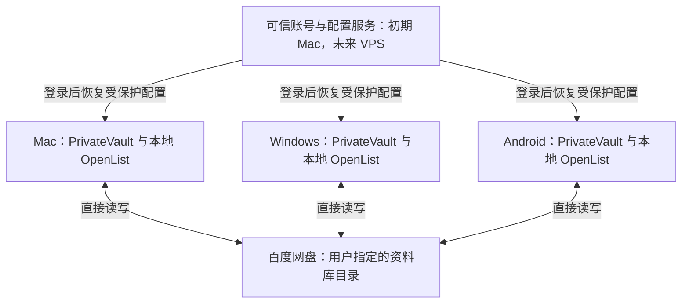

# PrivateVault 需求规格与架构设计

版本：v0.2 · 整理及审阅日期：2026-10-25（Asia/Shanghai）

状态：**本轮审阅完成，已获准加入项目；技术细节继续细化，未批准安装、部署或实现。**

本稿先在仓库外准备，经用户审阅后获准加入项目，并保留 v0.1。产品决策来自当前对话；标为“设计建议”“待研究”“待实测”的内容不代表用户已经批准技术细节。实际实施仍须另行获得用户明确批准。

审阅记录：2026-10-25，用户明确表示“审查完了，可以加入项目，可以保留 v0.1”。此次授权范围为保存设计文档。

## 1. 本轮结论与版本变化

PrivateVault 的定位是：**通过统一界面管理云端图片、视频、音频及 ASMR，支持可选加密、三端独立访问与归档。** macOS、Windows、Android 均为目标平台，无 iOS 要求。实用性优先于熟悉语言。

与 v0.1 相比，以下假设已由本轮讨论取代：

| v0.1 原建议或待确认项 | v0.2 本轮确认方向 |
|---|---|
| Mac 是唯一归档节点 | 三端各自通过本机 OpenList 访问、上传与加解密；三端均以支持本机链接归档为目标 |
| 所有资料必须加密 | 创建资料库时选择普通或加密模式；用户自己的敏感收藏优先采用加密库 |
| 首版默认由 Mac 编辑资料 | 优先三端编辑并同步；若冲突处理成本较高，首版允许指定设备整理资料 |
| 仅有统一 Web 界面 | 统一 PrivateVault 操作入口，底层本地执行能力与跨端集成方式须验证 |
| 各设备主要单独配置 | 独立 PrivateVault 账号，登录后恢复配置；允许可信账号服务器代管解密密钥 |
| 来源尚未明确 | 首批目标是 Pixiv 图片与 hanime1 视频，先支持单个作品/视频链接 |
| 元数据和媒体例行备份 | 默认只备份加密库恢复材料；媒体、元信息及其他设置备份为可选、默认关闭 |
| 离线使用作为可选体验 | 首版在线访问及必要缓存；主动离线收藏是明确的后续目标 |

## 2. 已确认产品决策

| ID | 决策 |
|---|---|
| D01 | 媒体库、详情、图片浏览统一在 PrivateVault；音视频优先内嵌，允许外部播放器补充 |
| D02 | 三端都能选择本机文件，经本机 OpenList 上传；加密库在本机加密，普通库按普通模式保存 |
| D03 | 三端均以支持手动粘贴来源链接、本机下载并归档为目标；源和平台逐项验证 |
| D04 | 优先三端修改作者、标签、封面、播放列表后同步；必要时首版降级为指定设备整理资料 |
| D05 | 加密按资料库设置；同一账户可以有多个不同模式的资料库 |
| D06 | 普通库的媒体与收藏资料以明文保存；加密库的媒体、封面、元信息及同步资料全部加密保存 |
| D07 | 支持接入已有云端媒体，仅扫描用户指定的目录，不自动接入整块网盘 |
| D08 | 默认保留已有文件名、内容和目录结构；用户可明确发起重命名、移动等操作 |
| D09 | 已有媒体自动生成必要基础资料，缺失信息可为空或手工补充；元信息集中在所属资料库的专用资料区 |
| D10 | 首批来源为 Pixiv 和 hanime1；先跑通单作品/单视频链路，再扩展批量及订阅 |
| D11 | 首版保留下载获得的文件，不自动转码；不兼容时允许外部播放器 |
| D12 | “移除收藏时同时删除云端文件”置于设置中，默认关闭，用户可手动开启 |
| D13 | 默认只备份加密库恢复材料；媒体、元信息和其他设置的额外备份均为可选、默认关闭 |
| D14 | 首版在线使用及必要缓存；后续必须规划主动下载收藏和断网浏览、播放 |
| D15 | 首版任务由发起设备完成，中断后由原设备恢复或重试，不要求跨设备接力 |
| D16 | 每条自动订阅由用户指定一台设备执行，允许更换；已开始任务仍由原设备负责 |
| D17 | 使用独立 PrivateVault 账号同步配置，追求新设备登录后减少重复设置 |
| D18 | 账号服务器属于可信环境，可以取得并代管解密密钥；这不是服务器无法解密的架构 |
| D19 | 初期账号服务运行在 Mac，未来可迁 VPS；Mac 睡眠时新设备登录/恢复配置可暂停，已配置设备仍以独立使用为目标 |

“指定设备整理资料”的退路只约束元信息编辑/发布，不取消其他设备的独立上传、链接归档或播放能力。

## 3. 产品范围与功能优先级

初期使用用户已有的百度网盘 6TB SVIP。容量是账户背景，实际剩余空间、API 配额及限速待核查。独立账号先服务于个人多设备使用；公开注册、多人共享或商业托管服务没有获得本轮确认。

| 层级 | 范围 |
|---|---|
| P0 可行性门槛 | 三端本地 OpenList/百度访问与加密读写、Crypt 互读、Range、Android 独立运行、来源适配、配额与恢复、可信密钥同步 |
| P1 首版闭环 | 独立账号、指定目录建库、普通/加密库、本地上传、单作品链接归档、基础资料与封面、浏览/播放、任务/日志、必要缓存、恢复材料导出、可用的跨端资料同步 |
| 后续明确目标 | 列表批量归档、指定设备订阅及切换、主动离线收藏和断网使用 |
| 后续按需扩展 | 跨端续播、可选转码、可选完整备份、其他来源、其他存储提供者、VPS 部署 |

后续明确目标的顺序尚未排期。Windows/Android 可行性是核心架构门槛，不能因为最终客户端分阶段交付而视为可选。

首版不要求：跨设备任务接力、全部网站通用下载、云端目录自动重排、全库预转码、公开匿名分享、自研加密算法、iOS。多人账号隔离的要求另行确认，不能从“独立账号”直接推定为多人服务。

## 4. 推荐整体架构

### 4.1 两部分职责

**账号与配置服务**负责 PrivateVault 登录、设备登记、配置版本、受控凭证与密钥分发；初期 Mac，未来 VPS。

**设备本地执行环境**负责用户界面、本地目录索引、来源下载、媒体探测、必要处理、上传、解密、播放和临时空间。三个平台各自访问百度网盘。普通库和加密库复用管理能力，加密库额外经过 Crypt。

该图是设计目标，不证明客户端集成已经实现。纯远程 Web 页面不能天然取得本地独立下载、加密、文件访问和后台运行能力。客户端壳、内嵌核心、伴随进程或受控本地页面的选择须单独研究。

### 4.2 必须保留的边界

- 账号服务器持钥是信任选择；媒体传输和解密仍可在设备直接完成，不要求所有媒体经账号服务器转发。
- 已配置设备应保存必要授权和配置；账号服务停止时，不因无法联系账号服务而立即禁止本地既有访问。云盘凭证失效、云服务故障或本地密钥不可用仍可能阻断使用。
- Mac 睡眠影响 Mac 自己的任务及其承载的账号服务；不能据此禁止 Windows/Android 执行各自的手动任务。
- 设备可以缓存目录和配置版本；界面显示最后同步时间及错误，不能把旧资料称为最新资料。
- 账号登录与百度/来源授权不同。目标是自动恢复配置，但设备绑定、令牌过期或平台要求可能仍需重新授权，不能承诺所有 Cookie 永久跨端复用。

## 5. 候选链路与技术证据

### 5.1 候选链路

| 候选 | 适用与限制 | 当前判断 |
|---|---|---|
| 本机 OpenList 百度驱动＋Crypt | 每台设备独立访问，复用现有加解密；普通库绕过 Crypt | 优先验证路线 |
| 本机 OpenList 密文 WebDAV＋rclone Crypt | 可提供独立 Crypt 工具出口，但多一层协议和平台打包依赖 | 保留替代候选，Android 成本需评估 |
| 集中式解密 | Mac/VPS 统一读取与解密，客户端较简单，但执行节点离线会影响播放 | 比较或可选访问模式；成功不能代替三端独立目标 |
| 浏览器直接读取百度并实现 Crypt | 涉及 CORS、请求头、密钥、随机读取、媒体流和移动后台限制 | 不推荐首版自研 |

每条加密链路只有一个预期 Crypt 层，避免向 Crypt 挂载点再次上传已经加密的文件。普通库路径也不能误走 Crypt 或误混入加密库。

### 5.2 本轮只读资料检查

以下为 2026-10-25 从官方仓库读取的源码/列表证据，没有安装、构建或运行。

| 检查项 | 直接证据 | 证据边界 |
|---|---|---|
| OpenList Mobile 本地服务 | `server.go` 提供初始化、启动和关闭本地核心的调用 [S1] | 不证明某个 APK 的百度/Crypt 功能、后台运行或与 PrivateVault 的集成已通过 |
| OpenList Crypt 上传/读取 | 驱动上传先调用 EncryptData 再交给下层存储；读取采用可定位解密逻辑 [S2] | 不证明百度具体接口和 Android 实际表现 |
| Pixiv 来源 | gallery-dl 官方支持列表包含 Pixiv 作品等入口，并列出 OAuth [S3] | 不证明当前用户授权、作品下载和三端打包已可用 |
| hanime1 来源 | 本次检索 yt-dlp 官方专用支持列表，未找到 hanime/hanime1 条目；列表也说明通用提取可能覆盖未列出站点 [S4] | 不能判定一定不支持，也不能承诺直接可用；需专门研究和授权样本验证 |

v0.1 中 rclone Crypt、OpenList Desktop、百度驱动等资料属于 2026-10-13 的历史调查，未在本轮全面刷新。尤其百度第一方 API 的授权、分片、限额和 Range 仍需重新核对。相关历史链接列在文末，不能当成当前运行结论。

## 6. 核心场景与验收要求

以下均为批准后的验收计划，**当前所有运行测试未执行**。

| ID | 场景 | 验收条件 |
|---|---|---|
| T01 | 三端独立访问与上传 | 已配置 Windows/Android 在 Mac 真实休眠后，仍能浏览、上传本机样本、读取云端结果；测试普通库和加密库 |
| T02 | Crypt 互读 | 三端写入的加密样本可交叉解密；读回哈希相同；测试中文、目录、空文件、边界大小和编码；rclone 互读另列矩阵 |
| T03 | 视频 Range/快进 | 冷缓存读取首、中、尾及跨加密块范围，与原样本逐字节一致；206/Content-Range/明文总长正确；非法范围 416 |
| T04 | 实际播放 | 冷缓存拖到 90% 无需下载整个前缀；分别记录内嵌/外部播放器、编码、码率、耗时及流量；Android 锁屏音频专项测试 |
| T05 | 账号与配置恢复 | 新设备登录独立账号后恢复库配置；密钥仅经授权下发；账号服务关闭后已配置设备按 T01 继续使用，新设备显示服务不可用 |
| T06 | Pixiv/hanime1 单链接 | 对每个源、每个平台分别记录授权、提取、下载、基础资料、上传与播放结果；一个源成功不代表另一个源成功 |
| T07 | 指定目录接入 | 只纳入选定目录；保留已有名称和布局；专用资料区不成为媒体；扫描范围外不读取、搬移或删除 |
| T08 | 资料同步 | 一端归档后另一端可发现并浏览基础资料；编辑冲突可解释，不静默覆盖；必要时按已接受的指定整理设备退路验收 |
| T09 | 中断恢复 | 下载、探测、加密、上传、提交阶段分别断网/关闭/睡眠；原设备恢复或重试，不重复产生可见收藏，不误清理未完成任务依赖 |
| T10 | 临时空间 | 预留、未知大小增长、磁盘不足、第三方缓存及取消清理均受控；活动文件不被清理；无空间则等待 |
| T11 | 删除设置 | 默认移除收藏保留云端文件；手动开启联动删除后，准确删除对应目标；其他库/范围外文件及本地源文件不受影响 |
| T12 | 恢复材料 | 在独立测试环境恢复完整 Crypt 配置并解密样本；无明文密钥/凭证日志；关闭可选备份时没有媒体/资料副本任务 |
| T13 | 后续离线收藏 | 用户明确选定并下载完成的资源，断网后可浏览、播放；普通缓存未完成时不能显示“可离线” |
| T14 | 后续订阅切换 | 用户指定、更换执行设备；归档游标延续，不因切换重复归档；旧设备恢复后不继续错误认领新任务 |

来源合集/批量测试在后续阶段增加。播放验证应覆盖实际收藏格式；容器/编码不支持与加密读取错误分别诊断。

## 7. 资料库与元信息

### 7.1 资料库范围与模式

每个库有稳定 vault_id、用户选择的云端根目录和创建时确定的普通/加密模式。同一账户允许多个库。是否递归、排除目录、重叠目录和跨库导入规则待细化；设计建议避免普通库扫描进入加密库的底层密文目录。

模式变更需要显式转换流程，不能仅改变布尔开关就把已有密文解释为明文，或声称已有普通文件已加密。普通库的账户凭证仍属于秘密，不能因媒体不加密而公开保存登录信息。

### 7.2 元信息来源与保存

- 基础资料：文件名可作为初始标题；大小和类型来自文件信息；时长、尺寸等通过媒体探测取得，远程探测可能需要读取部分甚至较多内容，成本待测。
- 来源资料：单链接归档尽量保留来源地址、作品标识、作者和源标题，记录获取时间及来源；缺字段允许为空。
- 用户资料：自定义标题、标签、备注、列表；用户覆盖与来源原值分开保存。文件名推断不能标成已核实作者。
- 云端专用资料区保存所属库的结构化资料、封面、缩略图和同步记录；不要求修改媒体原件。
- 每台设备保存可重建的本地查询索引；不能将正在使用的 SQLite 数据库直接跨端同步。

建议的逻辑目录名为 `.privatevault/`，只是候选名称。加密库中它及其内容应经库的 Crypt 规则保存，不能把明文标题或封面旁路放到云端。用户原有媒体布局保持原样，新归档的命名规则后续确定。

## 8. 同步与多端写入

将“上传媒体对象”“提交资料变化”“编辑整理信息”分开处理，避免把多端上传等同于全库同名清单互相覆盖。

**设计建议**：每端写入独立提交记录，记录全局唯一操作 ID、device_id、vault_id、基准版本和关联媒体；完整对象验证后再发布可见提交。设备按版本或事件建立索引。多个设备不能直接覆盖同一整库清单，也不能假定百度具备原子 rename、条件写或数据库事务。

三端编辑优先方案与退路：

1. 先评估受控版本合并：不相交字段可合并；同字段、删除与编辑、播放列表排序出现冲突时保留信息并提供明确处理。
2. 若开发与验证成本过高，首版由指定整理设备发布权威编辑结果；其他设备仍可独立上传和提交新增媒体记录。
3. 指定整理设备暂不可用时，新增媒体可以上传，但完整资料索引的可见延迟、其他端的读取方式必须在实现前说明，不能把“上传成功”误称“全端已同步”。

账号/配置同步服务与云端库资料区不是两个可同时任意写入的权威数据库。**建议**由账号服务负责账户、设备、凭证、库配置和订阅分配；云端资料区负责媒体索引与收藏资料；本地数据库作为任务状态和查询索引。若实现时需要中心协调资料编辑，应明确缓存、离线与恢复规则，不隐式依赖 Mac 始终在线。

“云端当前元信息＋各端查询索引”是正常同步体系。它不等同于额外、版本化的独立备份；用户关闭可选备份不应关闭正常元信息保存或同步。

## 9. 下载、处理、上传及播放链路

### 9.1 单来源链接

本机接收链接 → 检查支持源及授权 → 解析一个作品/视频 → 预留空间 → 本机下载 → 校验并探测基础资料 → 生成必要封面/缩略图 → 按库模式处理 → 上传 → 核验远端结果 → 提交媒体记录 → 发布资料变化 → 清理可清理的任务文件。

首版不自动转码或重封装下载文件；探测和必要缩略图不等同于转码原件。Pixiv 单作品可能含多张图片，是否默认完整收录同一作品的所有图片作为后续待细化项。

### 9.2 本地文件

用户在当前设备选择文件 → 当前设备探测并上传 → 使用同一验证和资料提交链路。不能将 Windows/Android 本地上传默认实现为先传到 Mac。文件选择器、Android 内容 URI 和后台任务权限属于平台适配问题。

### 9.3 普通与加密上传

普通库：媒体直接交给存储访问层；加密库：经过且仅经过一次匹配的 Crypt 层。底层可能采用流式上传或稳定密文暂存；不能假定零落盘、任意续传或加密后秒传。

设计评估需比较流式加密的磁盘优势与上传重试、分片哈希、随机读取的要求。同一上传会话重试不得混用重新加密后不同的密文分片。不支持字节续传时，允许重做本阶段，但界面必须如实说明。

### 9.4 图片与音视频

PrivateVault 提供列表、详情和图片浏览。音视频优先内嵌；不支持格式或需要其他播放能力时，交给外部播放器。本地服务向播放器提供受控的可读取内容，不把 Crypt 密文地址当作普通播放器可直接播放的地址。

加密读取由本机现有引擎处理随机解密；普通读取也需验证上游 Range、请求头和短期 URL。播放 URL 过期时允许受限刷新重试。代理响应应使用明文语义的长度、范围与类型。媒体不要求经过账号服务器。

## 10. 任务状态与恢复

每个任务有固定 owner_device_id；首版不自动转移执行中的任务。任务详情可后续同步显示，但检查点和临时文件不因此自动跨端可用。

阶段建议：RESOLVE/RECEIVE → DOWNLOAD → INSPECT → PREPARE → UPLOAD → VERIFY → COMMIT → SYNC → CLEANUP。PREPARE 在加密库使用 Crypt；普通库不进行 Crypt 加密。

状态建议：QUEUED、RUNNING、WAITING_AUTH、WAITING_SPACE、RETRY_WAIT、PAUSING、PAUSED、RECOVERING、CANCELLING、CANCELLED、FAILED、SUCCEEDED。阶段与状态分别保存；暂停状态只能在实际停止或到达安全检查点后确认。

| 中断位置 | 恢复规则建议 |
|---|---|
| 下载 | 保存来源标识、版本和可续传信息；来源变化后不得拼接旧文件 |
| 探测/必要处理/加密准备 | 不完整输出隔离或重做；原件不被覆盖 |
| 上传 | 查询会话和远端对象；可恢复则继续，否则原设备重传本对象 |
| 上传完成、未提交记录 | 对账后补交或隔离，不直接重复创建收藏 |
| 资料提交后、同步未完成 | 显示“已上传/待同步”，分别重试 |
| 清理 | 单独记录待清理，避免把已归档资源回退成下载失败 |
| 设备休眠/进程被系统终止 | 恢复网络后对账、更新本机执行租约，再恢复或重试 |

网络/5xx 退避重试；限流尊重服务端等待；授权错误暂停等待重新授权；不支持来源、权限拒绝、完整性失败不无限重试。次数、保留期和时间阈值留待验证，v0.1 的具体默认数值未获本轮确认。

## 11. 临时文件、缓存和离线

所有设备需要可配置工作区与配额。空间峰值评估包括下载文件、处理输出、密文暂存、工具内部临时文件、播放缓存及安全余量；流式方案仍要测真实峰值。未知大小任务随增长检查硬上限，空间不足则等待，不越过设定目录写满系统盘。

清理仅覆盖登记的专用工作区和缓存；活动文件、上传恢复依赖和用户原始本地文件不能被自动清理。取消/失败文件按明确策略保留；禁止跟随符号链接越界。外部播放器不可控缓存需要列出能力边界。

首版必要播放缓存采用配额管理，可被清理，不承诺离线完整性。后续正式离线收藏需要完整性状态、固定保留、离线元信息和断网播放；加密库的离线落盘保护与解锁方式另行设计，不能默认长期存明文。

## 12. 订阅及执行设备切换

每条订阅配置 assigned_device_id、assignment_revision、发现游标和成功归档记录。用户可更换设备：新设备接收后续检查及新任务；旧设备的已开始任务仍由旧设备处理。换设备不等同于转移半个文件。

跨端必须能够识别已归档来源作品，避免仅依赖下载器在某台设备上的本地历史。来源删除默认不自动镜像删除私人收藏，此项行为细节仍待确认。

**待研究的重要技术点**：旧设备离线后重新上线可能持有旧分配。需要验证分配版本、租约和交接规则，不能只把新设备 ID 写入一个文件就认为不会重复执行。账号/协调服务离线期间自动订阅是否继续，以及更换设备何时生效，尚未由用户确认。首版手动任务独立运行的要求不因此改变。

## 13. 账号、密钥与凭证保护

独立 PrivateVault 账号作为统一入口。账号服务可以恢复加密库解密密钥，客户端经授权取得必要配置；此处明确采用可信服务器模型，不宣称端到端零知悉。

设计要求：

- 登录密码以适当密码散列保存；库密钥、百度刷新凭证和来源凭证在独立秘密存储中受保护地保存。服务器存储加密密钥的保护密钥不能仅与业务数据库无保护地打包。
- 恢复配置经认证的加密连接下发；设备保存使用系统安全存储的能力待各平台验证，不直接假设 OpenList 客户端已实现。
- 账号登录密码、Crypt 内容密钥、来源授权和设备会话分别管理；重置账号密码不应直接改变 Crypt 配置而使已有文件不可读。
- 同库 Crypt 密码、password2/salt、文件名/目录模式、编码及根映射必须一致；默认值不能跨工具照搬。已写入后改变密钥或格式必须走迁移流程。
- 普通库也需要保护存储账户凭证。日志、诊断导出、普通库元信息和公开仓库不得包含秘密。
- 用户撤销设备会话不会抹掉它已持有的库密钥或文件。撤销既有设备的离线解密能力涉及库密钥轮换，此类失陷流程另行设计。
- 已配置设备离线于账号服务时的会话宽限、设备撤销生效时机和再次联网核验规则待确定，不能同时承诺无限离线与即时远程撤销。

账号服务初期在 Mac；Mac 睡眠时首次登录/配置恢复可用性暂停的边界已获用户接受。迁移 VPS 需保护服务、数据库与秘密，并继续保留客户端直连存储的路径。

## 14. 恢复材料与可选备份

默认范围是加密库恢复材料：完整解密参数、格式/版本、根映射、库标识及恢复说明。导出包应受保护地保存，恢复密码及保存位置后续确认；不能理解为默认把明文密钥上传到同一媒体目录。

默认关闭媒体、元信息及其他设置的额外备份，设置中提供可选功能。当前服务器里的活跃密钥副本和云端活跃目录不自动等同于独立备份。没有启用媒体备份时，恢复材料只能帮助解密仍存在的文件，不能恢复已丢失的媒体。

首版验收需要小样本恢复材料演练；不要求额外提供 6TB 备份容量，也不保留 v0.1 中未经确认的每日元数据备份与 RPO/RTO 默认承诺。

## 15. 删除与原文件保护

设置项“移除收藏时同时删除云端文件”默认关闭；关闭时保留文件并同步库内移除记录，避免下一次扫描立即将同一收藏重新接入。开启后才联动删除对应云端目标。

设置作用域、删除确认、云端回收站能力、共用原件引用与重复条目处理后续细化。不能假定百度或所有提供者都有同样的可恢复删除能力。任务取消、临时缓存清理、库内移除、云端原件删除和删除本地源文件是不同操作；本轮联动设置不授权顺带删除本地源文件。

默认接入保留既有命名与布局。手动移动/重命名后要保持索引关联；外部应用修改文件后的对账规则待设计，不仅以文件名判断同一媒体。

## 16. 模块与接口边界

以下是逻辑设计，不是已经存在的接口或必须采用的 URL。

| 模块/接口组 | 职责与契约 |
|---|---|
| Account / Device | 注册或初始化、登录、会话、设备登记/撤销；先满足个人多设备，公开注册待确认 |
| Config / SecretDelivery | 库配置版本、权限核验、秘密引用、受控恢复配置；秘密不进入普通元信息 |
| Vault / Catalog | 指定目录、模式、元信息、标签、作者、列表、版本；区分来源值与用户值 |
| SourceAdapter | 检查源能力、授权要求、解析单作品、下载；不接受任意可执行参数 |
| LocalJob / Workspace | 固定任务设备、状态/检查点、配额、取消与清理；不依赖中心持续认领手动任务 |
| MediaProbe / Artwork | 基础信息和封面/缩略图；首版不自动转码原文件 |
| StorageProvider | 目录/对象读写、Range、上传会话、校验及删除；声明真实能力 |
| CryptoAccess | 普通库直通、加密库 Crypt；逻辑路径和密文路径类型明确 |
| Playback | 图片、内嵌/外部播放器入口、受控明文 Range；云端凭证不嵌入长期 URL |
| CatalogSync | 新增/编辑/移除记录、幂等、版本、冲突与本地索引重建 |
| SubscriptionAssignment | 指定设备、版本、游标和交接；不自动接力运行中任务 |
| Recovery / OptionalBackup | 默认恢复材料；可选备份策略、导出与演练；默认值符合 D13 |

本机服务需要认证、Origin/Host 校验和受控监听，防止任意网页调用本机管理功能。跨平台界面如何连接本机服务、是否可内嵌，以及许可证和分发方式须专门验证。

## 17. 数据模型与提供者抽象

| 实体 | 关键数据 |
|---|---|
| User / Device | user_id、device_id、会话版本、撤销信息；不把独立账号等同于已完成多人隔离 |
| Vault | vault_id、provider_id、指定根目录、普通/加密模式、资料区、配置版本、整理设备（退路） |
| Provider / Capability | 类型、根映射、credential_ref、实际能力与最近核查时间 |
| CryptoProfile / SecretRecord | 解密参数版本、secret_ref、受保护秘密、密钥保护版本；不写入普通日志/目录 |
| MediaItem / Asset | 作品标识、类型、显示资料、原件/封面/缩略图、格式、时长、大小和对象定位 |
| SourceRecord | 来源适配器、作品 ID、规范 URL、授权需求、获取时间、源版本；不存原始 Cookie |
| Author / Tag / Playlist | 稳定 ID、关联关系、播放列表条目与排序版本 |
| CatalogOperation | operation_id、device_id、vault_id、基准版本、变更、提交完整性；支持冲突检测 |
| Job / Attempt / Workspace | 固定 owner_device_id、阶段、状态、幂等键、检查点、临时文件与租约 |
| Subscription | assigned_device_id、assignment_revision、检查游标、成功归档记录 |
| RecoveryExport / BackupPolicy | 恢复材料版本与演练结果；可选备份默认关闭，明确目标与保留策略 |

来源幂等候选键：来源＋作品 ID＋版本＋质量；相同文件不必等同同一作品，不自动抹掉来源和标签差异。对象位置、库内媒体 ID 与短期播放 URL 分开保存。

提供者能力应声明：Range、分片/恢复上传、条件写、原子移动、大小写、路径/文件上限、哈希、容量查询、删除/回收站、一致性。未知即不保证。优先 BaiduViaOpenList，未来可增加标准 WebDAV/S3；Crypt 不能替代底层驱动，也不能认为 rclone 原生直接支持百度网盘已被证实。

## 18. 技术选型与非功能要求

### 18.1 选型仍待跨平台验证

| 层 | 候选与建议 |
|---|---|
| 账号服务 | FastAPI/Python、Go 或其他成熟后端均可；原 Python 建议可以保留为候选，不因语言熟悉度定案 |
| 客户端界面 | Vue/TypeScript 等共享界面可评估；桌面壳和 Android 原生/跨平台宿主必须验证本地核心、文件与播放器集成 |
| 本地执行 | OpenList 核心优先；下载器和探测工具按平台可分发性选择；不能以 Mac 上 Python 工具可用推断 Android 同样可用 |
| 下载适配 | Pixiv 优先研究 gallery-dl 或允许的官方访问方式；hanime1 提取能力保持待研究，不承诺 yt-dlp 开箱即用 |
| 索引/任务 | 每设备本地 SQLite 可作候选；云端同步采用逻辑记录而非数据库文件复制；中心账户数据库独立 |
| 密码学 | 复用成熟 Crypt；平台不兼容时重审适配方式，不自研替代算法 |

原 v0.1 的“Python 后端＋Web 前端”不能直接视为新的三端客户端完整选型。尤其 Android 下载、探测与进程生命周期是阻断性研究项。安装包签名、开源许可证、现成应用间调用和自动启停能力另列检查清单。

### 18.2 非功能基线

- 可靠性：上传、验证、资料提交与跨端同步分别记录；不以进度 100% 直接判断归档完成。
- 独立性：已配置设备不通过另一台电脑完成自己的手动归档、读取和解密；账号暂不可用不强制终止既有使用。
- 隐私：加密库无云端明文媒体、标题、封面旁路；普通库的秘密仍受保护；可信服务器可解密的边界公开说明。
- 资源：所有平台配额覆盖工具与播放器缓存；文件大小不能等同内存占用；失败不无限占满工作盘。
- 可维护性：锁定核心/下载器/客户端版本；升级先做小样本互读、Range 和恢复回归。
- 性能：列表规模、首播耗时、拖动耗时、码率和内存目标待样本及设备确定；v0.1 数值不是已同意指标。
- 体验：同步/登录不可用、来源不支持、等待授权、空间不足、格式不兼容分别提示，保留可操作的恢复路径。

## 19. 安全、来源授权与日志

仅对用户自有、明确许可或适用规则允许的内容进行归档。登录授权、能够读取与获准自动下载是不同事项；来源逐项核查允许的访问方式，不把获取链接视为绕过访问控制的授权。本稿未访问、下载或保存来源站媒体。

下载适配器限制目标域名与重定向，防止链接访问本机、内网和云元数据端点；媒体文件名、压缩包或外部程序参数不能越界或执行任意命令。媒体探测设资源与时间上限。

日志默认保存任务 ID、阶段、字节和脱敏错误；不保存 Crypt 密钥、百度令牌、源 Cookie、带签名的完整地址或账户密码。来源 URL、媒体标题等隐私内容的日志保留策略待确认。普通库的内容不加密，不代表日志可泄露账户秘密。

## 20. Mac 至 VPS 迁移与恢复

迁移优先指账号/配置服务，不要求把客户端任务集中到 VPS，也不要求搬走百度中的媒体。

建议步骤：暂停账号/配置写入 → 导出一致的账户与配置状态及受保护秘密 → 安全迁移服务密钥和数据 → 更新服务地址与证书 → 样本登录/配置恢复验证 → 保留受控回滚点 → 停止旧账号服务写入。

如果同时承担订阅协调或资料合并，迁移还需保留分配版本、游标和提交顺序。VPS 作为订阅执行设备需要用户明确指定；没有跨设备接力能力时，不能迁移半完成任务并宣称继续执行。

常规额外备份仍按用户设置默认关闭；迁移期间的一致性迁移包与回滚点属于迁移操作范围，执行前单独说明。恢复材料与服务器密钥导出策略需要确保服务损坏时仍可重建加密库访问。

## 21. 风险、待研究及待确认清单

本轮不再重问已确认的大方向。以下技术细节可在后续研究中细化；遇到影响产品目标的阻断再回到用户决策。

| ID | 未解决事项 | 处理要求 |
|---|---|---|
| Q01 | Android 本地核心、下载器、媒体探测、文件访问与后台限制 | 先公开资料/源码研究，批准后样本验证；失败不能暗改为 Mac 代执行 |
| Q02 | hanime1 当前允许且可用的单视频提取方式 | 明确支持证据和授权条件；没有现成支持则评估成本，不承诺已支持 |
| Q03 | 百度 OAuth、应用资格、Range、请求头、上传限制与令牌跨端行为 | 第一方资料与用户授权环境分别验证 |
| Q04 | 新设备恢复配置、服务器地址发现、凭证过期及重授权 | 追求少配置；不以“同账号”掩盖必需授权步骤 |
| Q05 | 多端资料编辑、并发新增及索引可见性 | 评估事件/版本方案；必要时使用指定整理设备退路 |
| Q06 | 订阅改设备的生效时机、旧设备恢复及协调服务离线 | 明确租约/版本行为；不自动转移运行中任务 |
| Q07 | 恢复材料导出保护、保管位置、服务保护密钥恢复 | 满足默认恢复材料备份，不默认为其他内容备份 |
| Q08 | 指定目录递归、排除、重叠；文件外部改名/移动；扫描移除记录 | 保持范围清晰，避免反复接入已移除项目 |
| Q09 | 最大文件、缓存/工作配额、并发、清理期限与性能指标 | 按真实设备与样本决定；不保留未经确认的任意默认值 |
| Q10 | 删除设置作用域、共用文件、回收站、确认及失败恢复 | 默认保留云端；开启后的行为准确可测试 |
| Q11 | Android 锁屏播放、外部播放器、普通缓存及正式离线保护 | 分开验收；离线收藏为后续明确目标 |
| Q12 | 配置服务跨网络访问、TLS/私有网络、设备撤销和离线宽限 | 研究方案后再批准实际暴露/部署 |
| Q13 | 个人实例的账户初始化、注册入口、密码重置及邮件需求 | 不默认公共多用户托管；涉及发信或外部服务另定 |
| Q14 | VPS 预算、位置、版本分发和许可义务 | 可迁移目标保留；不提前安装或购买 |

## 22. 里程碑与阶段门槛

| 阶段 | 内容 | 门槛 |
|---|---|---|
| M0 当前设计 | 产品方向记录、技术研究、v0.2 审阅与待决项 | 当前未批准运行测试、安装或实现 |
| M1 Mac 基础验证 | 普通/加密库、百度授权、互读、Range、空间峰值和单来源提取 | 用户明确批准样本与工具范围后执行 |
| M2 三端可行性 | Windows/Android 本地上传、单链接下载归档、读取解密；Mac 真实休眠测试 | T01—T04/T06 的核心路径通过；两个来源逐项列结果 |
| M3 账号配置验证 | Mac 承载账号服务、可信密钥分发、新设备恢复、中心离线既有使用 | T05/T12；密钥和令牌不进入普通日志或资料区 |
| M4 首版最小可用 | 统一界面、指定目录、普通/加密库、单作品归档、资料/封面、播放、任务/空间/删除设置 | T07—T12；资料编辑采用已验证方案或用户接受的退路 |
| M5 扩展明确目标 | 批量、指定设备订阅及切换、主动离线收藏 | T13/T14；具体先后顺序另排，不把离线目标删为可选 |
| M6 部署与可选扩展 | VPS、更多来源/存储、可选媒体备份/转码/续播 | 按预算、需求与验证结果单独批准 |

设计批准不等于已通过可行性验证；可行性验证批准也不自动包含真实批量导入、公网部署或付费资源。当前仅将已审阅的 v0.2 设计文档加入项目，并保留 v0.1；未进行安装、部署或实现。

## 23. 资料来源与证据日期

### 本轮 2026-10-25 只读检查

- **S1**：[OpenList Mobile 本地服务源码](https://github.com/OpenListTeam/OpenList-Mobile/blob/main/openlist-lib/openlistlib/server.go)；读取的文件 blob SHA：`99a7c001819ba388e54b274ed461ee86dd5b7536`。
- **S2**：[OpenList Crypt 驱动源码](https://github.com/OpenListTeam/OpenList/blob/main/drivers/crypt/driver.go)；读取的文件 blob SHA：`7dca84283aca42d7cd21917d7c779db58fdb70e4`。
- **S3**：[gallery-dl 官方支持列表](https://github.com/mikf/gallery-dl/blob/master/docs/supportedsites.md)；读取的文件 blob SHA：`145749b52af614c2c4570ea24227860d1ddf6f6f`；包含 Pixiv 与 OAuth 说明。
- **S4**：[yt-dlp 官方支持列表](https://github.com/yt-dlp/yt-dlp/blob/master/supportedsites.md)；读取的文件 blob SHA：`ddc84161440c6ea9a78bbccd722ad0b1ad28cd33`；本次未匹配到 hanime/hanime1 专用条目，不能据此排除通用提取可能性。

blob SHA 用于识别本次读取的文件内容，不是仓库提交号；上述分支链接日后可能变化。

### 历史资料，仅承接 v0.1 调查

- [OpenList Crypt 文档](https://doc.oplist.org/guide/drivers/crypt)
- [rclone Crypt 文档](https://rclone.org/crypt/)
- [rclone 后端总览](https://rclone.org/overview/)
- [OpenList Desktop 官方仓库](https://github.com/OpenListTeam/OpenList-Desktop)
- [OpenList Mobile 官方仓库](https://github.com/OpenListTeam/OpenList-Mobile)
- [OpenList 百度驱动文档](https://docs.openlist.team/guide/drivers/baidu)
- [百度网盘开放平台文档入口](https://pan.baidu.com/union/doc/)

历史资料未在本轮全面刷新；百度第一方文档在初稿调查中读取失败。所有客户端兼容、网站下载、授权、速度、后台运行和 Range 的端到端结论仍待实际测试。
