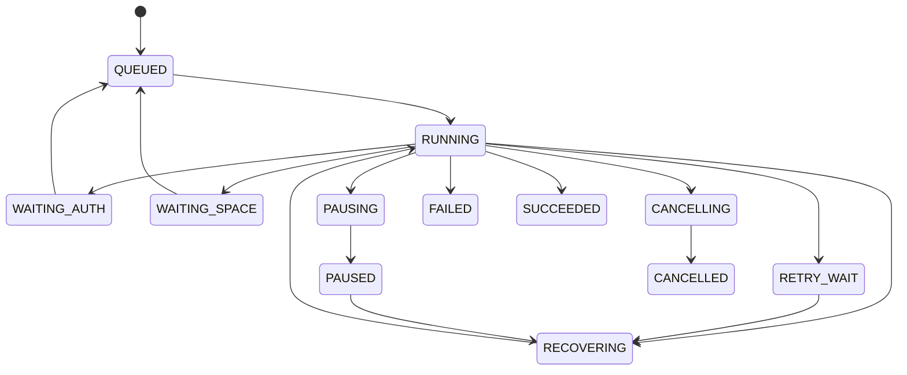

# PrivateVault 技术附录：模块契约、数据模型与恢复协议

版本：v0.1 · 日期：2026-10-28（Asia/Shanghai）

状态：**架构设计附录，不代表整份 API、数据库或运行协议已实现。** 2026-10-29 主稿 A01—A07 的设计选择及说明边界已获用户确认，后续 W01-M 已单独获准实施，实际结果以[报告 23](../validation/23-W01-M执行结果-v0.1.md)为准。Windows 实测暂缓；真实账号/云端、Android 桥接和其余业务模块未因 W01-M 获准而加入范围。

## 1. 应用结构与能力分层

建议初期采用模块化客户端和单个小型账号服务，不拆微服务，不引入消息中间件或云端转码集群。客户端内部模块通过类型化契约调用，任务与 outbox 使用本地事务协调。

| 模块 | 输入 | 输出/责任 | 不能据此承担的职责 |
|---|---|---|---|
| PlatformHost / CoreHost | 应用私有目录、核心版本、受控配置、文件选择请求 | 核心启动/停止/健康、仅本机端点、原生文件句柄、生命周期事件 | 不复用用户原 App 数据目录，不保证 Android 无限后台 |
| OpenListAdapter | vault_id、库内相对位置、文件流/范围、秘密引用 | 目录、对象信息、上传结果、内容读取、受控错误 | 不把 HTTP 200、目录可见或进度当完整成功 |
| VaultService | 选定根目录、普通/加密模式、完整 profile | 库标识、范围校验、本机映射、初始化/导入状态 | 不扫描整个账户，不隐式转换库模式 |
| CatalogService | 已校验资产、来源资料、用户修改、移除意图 | 作品/资产投影、字段级变更、冲突、列表/详情 | 不直接操作物理密文或任意覆写整库清单 |
| TaskEngine | 本地文件句柄或来源链接、目标库、任务选项 | 持久阶段/尝试、重试、取消、校验、提交与清理 | 不依赖下载器本地历史充当全库归档记录 |
| WorkspaceManager | 预计需求、实际增长、租约、活动引用 | 空间预留、受控路径、等待空间、可清理列表 | 不清用户原件，不按时间单独删除活动缓存 |
| SourceAdapter | 来源链接、授权引用、质量/作品选项 | 稳定来源 ID、作品资料、按序 AssetPlan、必要处理声明 | 不把短期 URL 当永久对象，不绕过访问限制 |
| MediaProbe / MediaAccess | 已授权文件流/句柄、探测预算、播放请求 | 类型/时长/尺寸、封面、受控本机媒体地址 | 不默认下载整库视频，不默认转码或长期存明文 |
| CatalogSync | 本机待发布记录、云端提交引用、当前检查点 | 发布/完整性确认、幂等应用、冲突与同步状态 | 不同步 SQLite 文件，不以最大序号代替缺口处理 |
| AccountConfigClient / Service | 设备会话、配置版本、提供者绑定请求 | 账户/设备/库配置、授权下发、凭证版本对账 | 不成为媒体中转，不假定登录等于上游授权 |
| SecretStore / CoreSecretPersistence | 秘密引用、授权范围、系统存储能力 | 本机秘密读写、核心副本保护策略 | 不把可逆混淆或 0600 权限称为完整密钥加密 |
| RecoveryService | 明确的导出范围、恢复口令、用户选定位置 | 受保护恢复包、格式校验、恢复说明 | 不默认备份媒体、来源 Cookie 或全部设置 |

本机文件契约返回受控句柄/可读流和可选大小。Android `content://` URI 不被猜成桌面文件路径；不能持久取得访问权限时，任务层在配额内复制到自己的工作区。读输入、摘要计算及探测放在后台执行环境，避免阻塞 UI。

## 2. 核心生命周期与本机接口

CoreHost 建议状态为 STOPPED、STARTING、READY、STOPPING、FAILED。`start` 对同一实例幂等；进程存在不等于 READY，需健康/版本/已管理存储状态符合要求。端口冲突时不接管未知进程。

桌面使用独立进程，Android 使用自有 Go/AAR/Kotlin 宿主。产品采用自己的私有数据目录、随机本机管理秘密与受控端口；不覆盖现有 Desktop/Mobile 配置。现成 App 间调用只能作为研发辅助，不成为正式依赖的稳定控制协议。

OpenList 已有接口映射候选：

| 逻辑调用 | 现有接口基础 | 适配层契约 |
|---|---|---|
| 登录本机核心 | POST `/api/auth/login` | 原生模块内部持有管理员能力，不交给来源网页 |
| 列举 | POST `/api/fs/list` | 验证库范围、分页、刷新；区分空库、未核实 profile、授权错误 |
| 对象信息 | POST `/api/fs/get` | 稳定定位与短期地址分离；原始地址不入普通日志 |
| 上传 | PUT `/api/fs/put` 或 `/api/fs/form` | 持久 attempt 在请求前记录；检查 HTTP 和业务错误码；返回不等于内容已验证 |
| 内容读取 | GET/HEAD `/p/*`、`/d/*` | 使用明文长度/范围；已知越界返回 416 和 `bytes */总长` |
| 存储管理 | `/api/admin/storage/*` | 仅管理本应用拥有的挂载；严格限制库/profile/本机映射 |

该表是接口设计映射，不是所有参数在新宿主中已通过。核心版本及 adapter 协议分别记录，升级需要小样本回归；不自动换用最新版本。

领域错误至少区分：AUTH_REQUIRED（注明 PrivateVault/百度/具体来源）、PROFILE_UNVERIFIED、INTEGRITY_MISMATCH、NEEDS_SPACE、INPUT_UNAVAILABLE、RATE_LIMITED（可带等待时间）、RANGE_NOT_SATISFIABLE（明文总长）、UNSUPPORTED_SOURCE、SCHEMA_UNSUPPORTED、PROVIDER_UNAVAILABLE 和 CANCELLED。原始上游正文/URL留在受保护诊断边界，不直接转发播放器或普通日志。只有实际完成 profile 核对时才报告明确参数不符，不把任何空列表都判断为密码错。

本机端点仅回环监听、访客关闭并有认证；来源文本按不可信内容显示。若使用 WebView，限制 Origin/Host/导航及原生桥接，不能加载来源页面后仍授予核心管理能力。外部播放器只取得本机受控文件读取能力，不能得到管理员 JWT、百度令牌或库秘密。

## 3. 提供者能力与定位

统一存储能力由 OpenListAdapter 暴露，Crypt 是库视图，不替代底层提供者。至少区分：

| 能力 | 取值要求 | 无能力/未知时的处理 |
|---|---|---|
| 范围读取 | 支持、实测受限、不支持、未知 | 有界回退或提示；不无限读取大段前缀 |
| 提供者哈希 | 算法、覆盖明文/密文、可信口径 | 不能把密文 MD5 当明文 SHA-256 |
| 上传恢复 | 字节级、阶段级、无、未知 | 首版允许重做本对象，使用新 attempt |
| 原子移动/条件写 | 显式证据 | 无证据则协议不依赖其原子性 |
| 目录一致性 | 分页、可见延迟、排序语义 | 使用操作 ID、缺口和重复扫描，不只信最后修改时间 |
| 容量/路径/文件限制 | 已知限制与未知项分别保存 | 不以 6TB SVIP 代替 API 配额或单文件能力 |
| 删除/回收站 | 支持范围及失败结果 | 默认不删除云端；启用后按明确 DeleteIntent 处理 |

持久定位采用 `vault_id＋库内相对位置＋可选提供者对象 ID/版本`。本机 `/crypt-test`、手机 `/PrivateVault-C1-Crypt` 等前缀只放 LocalMount，不同步为永久媒体位置。实际根通过 VaultConfig 映射；对象外部移动后标记缺失/待重扫指定范围，不扩大到全盘寻找。

## 4. 数据模型与权威位置

下列为逻辑表/记录，尚未生成迁移或代码。凡涉及多账户的数据均保留 account_id，但当前先服务个人实例，不默认开放注册。

| 实体 | 核心字段 | 权威/保护 |
|---|---|---|
| Account | account_id、登录标识、password_hash、状态 | 账号服务；口令使用成熟密码散列 |
| Device | device_id、account_id、installation_id、状态、登记版本 | 服务端设备登记，本机保留缓存 |
| ProviderConnection | provider_id、驱动、应用/授权类型、允许范围、能力 | 服务端配置＋本机能力记录 |
| CredentialBinding | binding_id、provider_id、owner_device_id、revision、secret_ref、刷新状态 | 受保护秘密；不能当普通目录元信息同步 |
| VaultConfig | vault_id、模式、provider_id、根定位、profile_id、配置版本 | 服务端配置；可用副本在设备 |
| CryptProfile | profile_id、不可变格式参数、secret_refs、profile_revision | 可信服务与本机秘密层；写入数据后不能直接换钥 |
| LocalMount | installation_id、vault_id、核心版本、虚拟前缀、本机端点引用 | 仅本机，不克隆成另一设备的运行配置 |
| MediaItem | item_id、vault_id、类型、标题、source_key、封面资产、状态、版本头 | 云端提交的本地查询投影 |
| Asset | asset_id、item_id、原名、MIME、相对位置、有效 attempt、大小、摘要、校验等级 | 云端逻辑记录；不存临时播放 URL |
| SourceRecord | 来源、稳定作品 ID、规范 URL、获取时间、质量、来源版本 | 按库模式保护；请求头/Cookie 另存 |
| Author / Tag / ItemTag | 稳定 ID、来源命名空间、名称、关联 | 原始资料与用户覆盖分开 |
| Playlist / PlaylistEntry | playlist_id、条目 ID、位置、列表基准版本 | 重排冲突保留，不假定最后时间戳正确 |
| Job | job_id、owner_device_id、阶段、状态、输入引用、attempt_id、幂等 ID、重试时间 | 本机持久任务库，不跨端接力 |
| UploadAttempt | attempt_id、job_id、预定远端位置、源大小/摘要、会话引用、状态 | 请求前持久化；会话信息属受保护数据 |
| StageArtifact / SpaceReservation | 所属任务、路径/句柄、用途、字节、租约/活动引用 | 本机；分离可删缓存与恢复依赖 |
| CatalogCommit / Outbox / Inbox | commit_id、actor_id、seq、父版本、payload 摘要、发布/应用状态 | 云端不可变记录＋本机事务队列 |
| EntityHead / Conflict | 实体版本头、字段冲突、候选操作、处理状态 | 由提交归约，可重建，不悄悄丢失修改 |
| SyncCheckpoint | vault_id、actor_id、连续高水位、已见 ID、缺口 | 仅本机派生同步状态 |
| RecoveryExport / BackupPolicy | 格式版本、范围、保护方式、用户位置、最近验证 | 不默认包含媒体或来源凭证 |
| Subscription | assigned_device_id、assignment_revision、游标、去重记录 | 后续功能；旧设备分配失效须有协议 |

新安装取得新的 installation_id/actor_id；恢复库配置不能复制旧设备的执行身份或把旧任务队列当新设备待办。作品来源幂等键与文件哈希分开：相同字节可能属于不同作品，不能自动丢掉来源差异。

## 5. 云端布局及已有目录接入

以下均为**逻辑明文路径**；加密库经 Crypt 后在百度呈现密文名称和内容。只是拟议布局，没有创建这些云端文件：

```text
用户指定的库根/
├── 原有目录与媒体                       # 默认不搬移、不改名
├── media/<asset_id>/<attempt_id>/<原文件名>  # 新归档对象，各尝试独立位置
└── .privatevault/
    ├── vault.json                      # 最小、稳定的库描述，不放秘密
    └── commits/<actor_id>/<seq>-<commit_id>.json
```

库描述包含 vault_id、根格式版本、初始 profile_id 等非秘密信息。连接已管理库时，与可信配置/恢复材料核对身份；连接没有描述文件的既有 OpenList 库时，先区分“未启用 PrivateVault 管理”与“profile 未核实”，不能因为解密列表为空就写新资料并认定是新空库。

启用 PrivateVault 管理需要清楚说明会在选定目录添加专用资料区。只读浏览/导入已有配置不自动改写原文件。初始发现可递归指定范围，但排除资料区、底层 cipher、缓存及显式排除目录；库根重叠默认拒绝或显式解决。

已连接的旧媒体用原位置引用。标题可由文件名初始化，大小/类型来自对象信息；作者、时长等未知则为空。远程探测有预算，必要时按用户访问逐步补齐，不在建库时强制全量下载 6TB。

## 6. 资料提交协议（候选 v1）

### 6.1 不可变记录与完整性

每条提交有唯一 commit_id、安装实例 actor_id 和该库内持久递增 seq。业务 payload 包含 vault_id、实体操作、基准/父版本及引用资产。候选封套以 base64 保存原始 UTF-8 JSON payload 字节，并记录其字节数和 SHA-256，避免不同语言重排 JSON 后把摘要计算口径弄混；具体字段在首个协议工作包冻结。

读端检查：完整 JSON/字段类型、payload 长度和摘要、库 ID、操作 ID/序号一致性、支持的 schema、路径范围及引用资产状态。半截/不兼容记录进入待核对或版本不支持，不应用到可见索引。checksum 检测损坏，不是普通库记录的数字签名；不承诺能识别持有云盘写权限的恶意伪造者。加密库仍由 Crypt 保护云端内容，资料文本不能执行命令或获得本机管理能力。

相对路径归一化后必须仍在当前库内；拒绝绝对路径、上级穿越、NUL 与平台分隔符歧义。原始来源文件名作为资料保留，物理文件名经过平台/提供者约束处理，不用标题直接拼接命令或任意本机路径。

同步记录只用于资料投影，不作为可执行任务、权限授予或本机文件操作指令。物理删除由发起设备上获准的持久任务负责，其他设备应用墓碑；不能仅因拉到一条记录就执行本地删除、shell 或任意来源下载。

新媒体先写独立 attempt 路径，校验后再发布引用它的提交。任何时刻都不依赖“先写临时文件，再原子 rename 为提交”的假设。未提交媒体不进入 PrivateVault 已归档列表，但外部网盘工具可能看见实际半成品。

### 6.2 本机与云端的非原子衔接

1. 源输入稳定，持久化 asset/attempt 的预定位置后上传。
2. 完整性通过后，本机事务写资产事实、资料变更及 READY outbox。
3. 发布唯一 commit_id 的云端记录，并读回确认完整。
4. 本机事务将 outbox 标记 PUBLISHED，资料状态为已归档。
5. 各端拉取并幂等应用记录，更新本地检查点；清理独立进行。

崩溃后按同一 commit_id 查询/核对已有提交：相同内容确认成功，不重复创建收藏；同 ID 不同内容视为冲突/损坏，不覆写。云端已出现完整提交而本机未标记完成时，其他设备可先发现它，本机恢复后对账即可。

seq 与 outbox 在同一本机事务中分配，不能为每个刚排队的下载任务提前占号。提交一旦进入不可撤销的发布步骤，取消按后续移除/补偿操作处理，不能删掉记录或复用同 ID 改内容。缺口用于同步检查点，不是全库阻塞栅栏：父依赖齐全的后续独立提交可先应用，检查点仍保留缺口，不靠最大序号掩盖它。

### 6.3 同步与冲突

| 情况 | 建议行为 |
|---|---|
| 重复拉取 | 按操作 ID 去重，本机事务只应用一次 |
| 序号 8 先于 7 出现 | 保留缺口，连续高水位不越过缺口；有界重扫，不只保存最大序号 |
| 不相交字段并发修改 | 基于父版本与触及字段合并 |
| 同一字段并发不同修改 | 保留候选值，显示冲突；显式解决操作引用双方版本 |
| 相同字段改成相同值 | 可合并，但保留操作来源 |
| 移除与迟到编辑并发 | 墓碑不被普通编辑自动复活，保留冲突/恢复入口 |
| 播放列表并发重排 | 初版按整列表基准版本处理冲突，不声称无损实时协作 |
| 两端同时归档同一来源 | 检测 source_key 重复并对账，保留资产，不承诺云端没有任何额外对象 |

不依靠墙钟确定所有先后，也不宣称百度存在跨设备唯一约束或 exactly-once 上传。任务侧至少一次执行与逻辑操作幂等分开。初版不自动删除旧提交；后续压缩需先设计快照、离线设备追赶及格式升级。

## 7. 任务状态机与恢复

2026-10-30 补充：来源订阅的单件失败隔离、仅新增归档、来源移除保留、多图整体完成与有限重试行为已由用户确认，见[决策 26](26-BoxPlayer借鉴与订阅归档决策-v0.1.md)。这些是后续来源/任务模块的设计约束，尚未实现。

阶段与状态分别保存。阶段为 ACQUIRE/RESOLVE、DOWNLOAD/IMPORT、INSPECT、PREPARE、UPLOAD、VERIFY、COMMIT、SYNC/CLEANUP；PREPARE 不把预加密文件再次交给 Crypt。



取消或暂停请求不直接等于已经停止；到安全检查点或确认传输终止才更新终态。清理失败用独立待清理标记，不将已成功归档倒退成下载失败。

重启时扫描本机未终结的 RUNNING/PAUSING/CANCELLING 状态，按持久检查点进入 RECOVERING 或继续取消；不把进程已消失当任务成功。排队、等待或已暂停任务也可取消；没有活跃操作时可直接进入 CANCELLED。手动重试 FAILED 需产生明确重试动作，不无限自动循环；这些补充边界不在上图逐一展开。

| 中断点 | 本机恢复依据与动作 |
|---|---|
| 下载未完成 | 核对来源 ID、版本/长度及服务器续传条件；来源变了不能拼接旧片段 |
| Android 文件句柄失效 | 有稳定副本则继续；否则等待重新选择并核对原摘要，不能假装可读 |
| 上传中断 | 核对原 attempt；无可靠字节续传时用新 attempt 位置重做本对象 |
| 上传结束、校验前崩溃 | 先按预定位置读回校验，完整则继续，不先重复上传 |
| 校验失败 | 保留错误和隔离尝试，不发布资料；原件及恢复依赖不自动删 |
| 云端提交完成、本机未标记 | 按 commit_id/摘要对账后补确认 |
| 已归档、其他端未同步 | 显示“已归档/资料待同步”，分别重试 |
| 清理中断 | 可重新清理已登记且无活动引用的文件，不重传媒体 |

网络/5xx 有界退避并加抖动；限流尊重 Retry-After；上游授权失败进入带提供者范围的 WAITING_AUTH；PrivateVault 账号、百度授权及 Pixiv 授权不能混为一个“请重新登录”。具体次数/间隔是后续参数，不复用验证脚本的超时当产品默认值。

## 8. 校验等级、缓存和垃圾回收

| 等级 | 含义 | 对外表述 |
|---|---|---|
| UNVERIFIED | 只得到上传返回或进度 | 未校验，不当完整归档 |
| SIZE_CONFIRMED | 远端长度与预期相符 | 仅大小已核对 |
| PROVIDER_HASH | 对正确明文/密文口径的提供者哈希已核对 | 标明算法/口径，不冒充明文完整读回 |
| FULL_PLAINTEXT_SHA256 | 完整解密读回与输入摘要一致 | 当前对象内容已完整校验 |

E1 建议采用最后一级。若后续因大视频成本选择其他策略，需要用户可理解的等级和能力证据。现成核心没有向适配层提供预期密文哈希/会话续传能力时，不能仅凭“底层大概有 MD5”就采用优化路径。

预留应计入受控输入副本、必要输出、可能的完整密文缓存、第三方临时文件、播放缓存及余量。流式摘要不要求第二份完整明文，但其他组件是否零落盘、是否复制输入仍需在实施阶段测量。未知大小下载持续记账，达到上限进入等待空间。

自有文件按 StageArtifact 登记；核心 TempDir 单独受总配额管理。无法把核心临时文件可靠关联到单个任务时，只在核心空闲/停止的安全点清理已确认范围，不按 TTL 扫删活跃目录。不得跟随符号链接越界，不能把用户原始路径加入临时清理列表。

未提交对象可能属于其他离线设备的活动尝试，不能看到“暂时没被索引引用”就立即云端回收。首版默认保留云端残留并显示诊断；自动清理需所有者、租约/引用与安全期的明确协议。移除收藏默认只发墓碑；设置启用物理删除后，使用单独 DeleteIntent 和引用/范围核对，不与普通取消/缓存清理混用。

## 9. 凭证、设备与核心持久化

### 9.1 版本与刷新所有权

VaultConfig/CryptProfile 与 CredentialBinding 使用不同版本。新设备恢复配置不等于复制另一设备的刷新身份。库 profile 写入数据后不可直接变更，账号密码重置不改变它。

优先采用已证实可独立的设备授权链；百度当前是否允许所用应用生成独立链仍未确认。若选共享链，必须先选真正的刷新所有者/桥接策略；核心原生自动刷新需要被该机制覆盖，不能只给 UI 或同步线程加锁。凭证回传使用基准版本条件更新，冲突进入对账，不能任意采用较大本地计数或最后上传的字符串。

| 账号服务状态 | 已配置设备 | 新设备 |
|---|---|---|
| 在线 | 本地媒体访问，按策略同步配置/凭证 | 登录、登记、恢复 profile；必要时完成上游授权 |
| 离线且本地授权有效 | 继续本地媒体操作；待发布资料可直接按云端协议同步 | 首次登录/恢复配置暂停 |
| 离线且上游授权已失效 | 按绑定策略处理；中心刷新路线可能等待，独立链也取决于提供者 | 不承诺凭空恢复访问权 |

这里明确账号服务离线与百度网络故障是不同问题。真实凭证轮换未被本次功能测试证明，不能用一次配置导入成功作永久并发安全保证。

### 9.2 本机秘密副本

建议 PlatformSecretStore 通过系统支持保护应用秘密；加密本地索引可另用 SQLCipher。但 stock OpenList 的配置数据库仍可能保存可恢复的密码/salt与令牌副本，必须纳入同一威胁模型，不能以另一份 Keychain/KeyStore 副本宣称已经解决。

A03 有两种明确边界：

- 实用基线：可信本机、应用私有目录与权限、系统安全存储和设备磁盘保护；承认可读取核心配置的人可恢复其秘密。不假定用户当前已启用 FileVault/其他系统保护，也不自动修改设置。
- 强保护路线：实现并维护 CoreSecretPersistence 桥接，在核心保存/刷新处写入秘密引用，将真实值交给受保护存储并在初始化时解析；需涵盖后台刷新、导出、崩溃与恢复。现成 HTTP API 本身没有替本项目完成该路线，不能承诺“少改一个配置项即可”。

用户于 2026-10-29 确认前者作为首版边界，后者保留为未来增强路线；不宣称现成核心配置已获得系统秘密存储的同等保护。保护措施仍须后续落实与验收，研发切片只用自制测试资料。元信息临时明文、媒体探测输出和播放器自身缓存也需在本机策略中如实列出，不承诺零明文痕迹。

## 10. 账号服务、恢复与迁移契约

服务采用个人实例初始化账户，不默认邮件注册。建议资源契约包括会话、设备登记/撤销、配置版本查询、库 profile 授权读取、提供者设备绑定及凭证版本更新；这些是逻辑 API，尚未生成服务代码或暴露端口。

客户端请求不能自行指定任意 account_id 越权；身份由会话导出。账户密码采用成熟散列；设备会话与 Crypt、来源凭证分开。服务端秘密使用成熟 AEAD/信封加密，保护密钥不和业务数据库无保护地放在同一迁移包。首次 Mac 跨设备连接的地址、可信 HTTPS/TLS 入口和设备配对方式需在部署工作包明确，不以“同一局域网”代替认证或明文传密钥。

恢复包默认包含完整 Crypt 格式/密钥、库 ID 与根映射、格式版本和恢复说明，不克隆设备身份、未完成任务、百度/来源凭证或 6TB 媒体。用户已确认采用标准 age 独立口令加密，具体库/绑定和文件选择方式在后续工作包冻结，实际位置及口令由用户在导出时确定；恢复材料可帮助解密仍存在的媒体，不能恢复已丢失媒体。

Mac→VPS 迁移顺序：暂停账号/配置写入 → 一致导出账户配置及受保护秘密 → 验证格式/摘要 → 恢复密钥与服务 → 更新地址/TLS → 小样本登录/恢复验证 → 切换单一写入方 → 保留受控回滚点。迁移账号服务不搬移媒体，不把旧设备的半个下载任务接力给 VPS。

用户明确选定设备后的自动订阅以后加入 assignment_revision 与租约。协调服务不可用时不自行转移任务；旧设备重连需检查分配版本。手动本机任务与自动订阅的协调可用性分别设计。

## 11. 来源执行与许可边界

SourceAdapter 返回稳定来源 ID、作品资料、有序 AssetPlan、授权要求、版本及必要处理声明。来源 Cookie/令牌、请求头和短期媒体 URL 只放受保护执行上下文；规范来源 URL 与标题也按不可信资料显示，不执行 HTML/脚本，不拼接 shell 参数。

图片可含多页；作品与文件分开，页序保留。原图与来源封面、用户封面分别记录。既有资料缺作者/标签不能猜成已核实来源；已有媒体探测按成本渐进完成。

桌面 gallery-dl 外部执行是候选；Android 的 Chaquopy/Python 3.11+ 依赖与原生组件不能仅由源码最低版本推断可打包。既有研究记录 gallery-dl GPL-2.0-only、OpenList/Mobile AGPL-3.0、Desktop GPL-3.0 等不同许可；不把 GPL-2.0-only 代码与 AGPL-3.0 直接链接为一个应用并假定兼容，也不把分进程当成自动免除义务。实际组合与发布包需单列核对，当前不对外分发。

hanime1 保留为目标，允许且可用的提取方式未证实；未知时显示不支持/待支持，不偷偷换来源。源站访问授权、网络限制、凭证流向、必要合并/封装与转码分开，首版不自动转码。外部解析器的网络访问同样需要限制本机/内网/云元数据地址及重定向，不能只检查最初用户粘贴的主机名。

## 12. 首个工作包的验收与后续边界

建议最先批准的是 W01，而非一次性实现整份设计。其候选范围是自有宿主/核心生命周期及 Local 测试存储；不接入用户原配置或真实百度/来源秘密。依赖安装、构建、设备操作、文件清单及验证步骤应在 W01 实施提案明确后再执行。

| 工作包边界 | 必须验证的性质 |
|---|---|
| W01 核心宿主 | 独立目录、受认证回环端点、版本兼容、幂等启动/停止、失败可解释 |
| W02 库/profile | 普通与加密视图只经过所需层；未核实配置不报空库成功；根映射与本机前缀分离 |
| W03 任务 | 请求前持久检查点；半成品不能提交；崩溃后先对账再决定重传；清理不碰源文件 |
| W04 提交/同步 | 重复、乱序、缺口、半截提交、字段冲突及墓碑都有可解释结果 |
| W05 媒体 | 界面可读、实际播放/定位；越界语义、短期 URL 失效和敏感错误过滤 |
| 完整首版补齐 | 账号恢复、凭证策略、双来源、跨端资料、恢复包与设置行为按 v0.2 验收 |

Windows 当前不追加实机测试；批准实现后，必要的单工作包集成验收应明确范围，不以旧 OpenList App 的成功代替新宿主通过，也不在现在启动相关试验。

## 13. 本轮新增公开资料快照

以下于 2026-10-28 通过 GitHub 连接器只读获取；固定提交的 README blob 与首次读取摘要再次核对一致。均为能力/选型证据，**没有安装、编译或运行这些候选组件**。完整记录见 [20-公开资料快照.json](20-公开资料快照.json)。

| ID | 固定来源 | 使用结论 |
|---|---|---|
| S01 | [Flutter README](https://github.com/flutter/flutter/blob/087a1b62b8996c328f12708c46ca060dba5fdf1d/README.md) | 声明覆盖 Android/macOS/Windows，并提供平台通道/FFI；不等于本项目宿主已完成 |
| S02 | [官方 video_player README](https://github.com/flutter/packages/blob/13d38e0d97a8e1227379f2887847bc178f22c73a/packages/video_player/video_player/README.md) | 本次平台表未列 Windows，不能直接充当三端统一播放器结论 |
| S03 | [media_kit README](https://github.com/media-kit/media-kit/blob/c533e446755f51cf53c7e57aea873f2aa5355f81/README.md) | 声明三目标平台音视频能力；仍需原生库、打包、格式/播放及最终二进制许可核对 |
| S04 | [flutter_secure_storage README](https://github.com/juliansteenbakker/flutter_secure_storage/blob/e8eeb449cd512b26153f0a3376dfe374dd39a999/README.md) | 提供平台秘密存储，不能自动保护 OpenList 另外写入的数据库；develop 文档不等于已冻结发布版本 |
| S05 | [age README](https://github.com/FiloSottile/age/blob/b74dce4cdbe35b5e5f66c06d9612b72f89028758/README.md) | 有标准口令保护文件流程；设备绑定/导出仍需本项目整合 |

已归档依据继续引用：本地核心/SDK 边界及许可证见[研究 01](../research/01-三端本地OpenList复用可行性-v0.1.md)，来源/Python/许可见[研究 02](../research/02-来源适配与Android下载运行环境-v0.1.md)，刷新与上传缓存见[研究 03](../research/03-百度授权Crypt上传与Range链路-v0.1.md)。可逆混淆的本机核对和配置差异见[记录 15](../validation/15-Android测试Crypt配置与读取范围-v0.1.md)，当前成功范围见[报告 18](../validation/18-Android加密上传与Mac独立读回结果-v0.1.md)。历史与当前证据日期分别保留。
