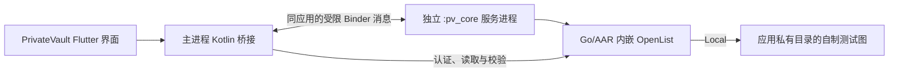

# W01-A 实施提案：PrivateVault 安卓本机核心

版本：v0.1 · 日期：2026-10-30（Asia/Shanghai）

状态：**下一工作包的具体提案，尚未批准安装工具链、编写 Android 实现或操作手机。** 本轮只核对代码、工具元数据与公开资料；没有运行 adb、下载 SDK、构建 AAR/APK 或接触手机配置。之前的明确实施授权为 W01-M，结果见[报告 23](../validation/23-W01-M执行结果-v0.1.md)。

Owner 当前主要判断目标、关键取舍和验收效果；本提案不安排源码阅读或语言学习。源码统一阅读仍留到整个项目完成后。

## 1. 这一步完成后能做什么

手机上出现独立的 PrivateVault 开发应用，可在自己的界面启动、停止和重试本机 OpenList 核心，并通过核心读回同一张自制 `样本.png`，显示内容校验一致。

应用不依赖 Mac 提供媒体服务，也不调用手机上已安装的 OpenList 应用。原 OpenList、百度挂载、备份和文件都保持原样。测试只使用安装包内的自制图，尚不连接百度，不导入 Crypt 密码，不提供上传、播放或账号登录功能。

推荐顺序保持为 **W01-M → W01-A → W02**。先验证自有 Android 宿主能构建和可靠启停，避免大量后续实现建立在未经验证的宿主之上。既有 OpenList Mobile 成功是参考，不能代替 PrivateVault 的集成验收。

## 2. 开发与手机安装分开

| 批次 | 允许推进的目标 | 结束时交付 |
|---|---|---|
| W01-A 研发，当前请求批准 | 项目专用工具链、原生绑定、共享界面适配、构建和无设备检查 | AAR、arm64 Debug APK、实际版本/摘要/权限清单与结果报告 |
| 手机安装与实机验收，APK 出来后再具体确认 | 用户审阅成品后，决定自行安装还是授权指定设备调试/安装 | 安装后前台启停、读取、异常和生命周期证据 |

**批准研发不自动开启 USB 调试、不启动 adb、不安装手机应用。** APK 成形后再提供具体安装方式、包名、签名、大小和影响，安装前不索要手机密码、网盘配置或授权备份。构建成功只能记研发批次完成，实机验收完成前不能记整个 W01-A 或 W01 通过。

现有手机信息沿用用户报告：一加 Ace 5 Ultra、Android 16、OpenList Mobile `v4.2.5.26080717 (150)`。当前没有连接手机验证其 ABI、页大小或安装状态。

## 3. 推荐结构与行为

界面、CoreHost 契约及测试图沿用 Mac 工作；核心执行放入自有、非导出的 Android 服务进程。AAR 的 Go 运行时只在这个进程加载，不把 JNI 初始化放进主界面进程。

主要行为：

1. 用户点击启动，主进程建立本次实例 ID，绑定服务；服务先准备私有配置与临时管理秘密，再初始化核心。
2. 核心仅监听 `127.0.0.1`，验证上游版本/自有构建标识、实际认证、访客限制、图片名称/大小及完整内容后才显示就绪。
3. 用户停止时先关闭 HTTP、完成必要 DB 同步，返回预期停止状态；随后结束**本应用自己的核心服务进程**，下一次使用新进程，避免依赖 Go 全局状态可无限次重初始化的假设。
4. 主界面死亡、绑定断开或本轮前台生命周期结束时，核心侧做受控停止；核心进程意外死亡时，主界面显示可重试错误。
5. 本轮先采用明确的前台范围：切到后台时停止核心，返回后可重新启动。长期锁屏、后台音频、下载队列与订阅另做，不借“前台成功”承诺后台常驻。

服务 `exported=false`，不采用独立隔离 UID，因为核心需要本应用私有目录及网络能力。使用系统 Messenger/Binder，不新增大型 IPC 框架；消息核对调用 UID、实例与代次。主进程维护递增状态序号，旧核心的迟到消息不能覆盖新状态，核心换进程也不会因序号归零卡在旧状态。

## 4. 工具链候选已具体固定

以下是取得公开证据后的构建候选，**不是已经组合运行通过的版本**。详细来源、blob 与准备记录见[快照 24](24-W01-A准备快照.json)。

| 项目 | 固定候选 | 本机状态/影响 |
|---|---|---|
| Flutter | 已有 3.47.5，提交 `6a19cca56475dbfba1478ee68d7bd0c2ef891da1`；Dart 3.13.4 | 复用现有项目 SDK，不换版本；Android 引擎构件可能继续下载 |
| Go | 官方 go1.27.3，darwin-arm64；68,196,737 字节 | 需要新增到项目 `.tools/`，不安装全局 Go |
| gomobile/gobind | `golang/mobile` 提交 `19777044486779222400e9ca16c4306f9c6dbfa9` | 用上述 Go 编译，两个工具使用同一提交，不使用 `@latest` |
| OpenList | v4.2.8 源码 `25e4eb663ffb73991a68d85df4f690d48ad137a6` | Android 需自编译；不能使用 Mac 的 darwin 二进制 |
| JDK | 已有 OpenJDK 17.0.15、aarch64 | 已读取 release 元数据；不更换或升级现有 Java |
| Android SDK | compile/target 36，build-tools 36.0.0 | 本机目录及元数据存在，复用 |
| NDK | 28.2.13676358 | 本机存在；宿主 clang 文件为 arm64/x86_64 通用二进制，不因目录名含 x86_64 就要求安装 Rosetta |
| Gradle | 9.3.1，官方 `-bin.zip` | 版本跟随固定 Flutter 模板，采用 bin 包减少文档/源码下载；项目专用缓存 |
| AGP / Kotlin | 9.1.0 / 2.4.0 | 固定 Flutter 的模板值；AGP9 的 Kotlin/DSL 兼容开关与实际插件应用必须核对后构建 |
| 最低 API / ABI | 开发包 minSdk 24、仅 arm64-v8a | 目标是当前 Android 16 手机；不宣称所有 Android 7+ 设备已测试 |

Go 归档 SHA-256：`dd3908cf20959d798c1e06ebe5b72213f0505ce01373b40ce3110975a6cd99c2`。

Gradle 9.3.1 bin 归档 SHA-256：`b266d5ff6b90eada6dc3b20cb090e3731302e553a27c5d3e4df1f0d76beaff06`。

Go 模块声明 `go 1.26.0`、`toolchain go1.27.3`，所选 gomobile 模块也要求 Go 1.26.0，故候选选择 go1.27.3。构建限定本地已选工具链，不让 Go 自动切换到未记录的新版本。

**Java SDK 级别与原生 API 级别分开**：本机 NDK 的元数据范围为 API 21—35；Go 原生绑定明确使用 API 24。生成 Java 绑定时通过 gomobile 的 `-bootclasspath` 使用已有 `android-36/android.jar`。不把 compileSdk 36 误传为 NDK 原生 API 36，也不默认新增 SDK 24。

## 5. Android 核心怎么复用

推荐只编入当前需要的 **Local、百度网盘、Crypt** 驱动，保留提供者抽象；不因这一步引入无关云盘驱动或下载器。实际编译能力单列清单，不把裁剪绑定说成官方完整发行包；未来增加提供者需扩充清单与回归。

Go 绑定准备在固定核心源码模块内叠加自己的小包装，以合法访问其 internal 包；源码副本位于忽略的 `.tools/src/`，自有包装和变更记录保存在项目 `native/openlist_bridge/`。不直接执行 Mobile 的动态取最新、删除/移动源码及 `replace ...@latest` 初始化脚本。

需要处理的具体边界：

- 只用固定源码和必要的安全包装，不改 Crypt 算法。Go 初始化在服务进程内只进行一次，跨次重启通过退出自己的服务进程实现。
- Mobile 参考包装会记录管理员密码；不照搬这一方法及原始日志透传。初始化、服务配置、签名密钥和 JWT 均留在原生/服务内部，不进入 Dart 快照或普通日志。
- 核心路由初始化需要 `public/dist`，并读取 index 与静态目录。此包采用自有的最小无脚本、无外链静态占位资源，保留 index 及 assets/images/streamer/static 目录和可嵌入占位文件；不依赖 Go embed 保留空目录。不构建另一套 OpenList Web 前端，仍须实际验证路由可初始化。
- 自编译 AAR 的上游版本、提交、包装版本、资源摘要和驱动集合分别记录。CoreHost 的上游基线仍为 v4.2.8，自有构建 ID 单列，不把它假称为与 Mac 官方二进制同一构件。
- Go/AAR 的 `.so` 放进 APK 原生库目录；不把可写数据目录中的 Linux 可执行文件当作 Android 宿主路线。

## 6. 本轮的文件范围

| 范围 | 预计新增/调整 | 责任 |
|---|---|---|
| Android 工程 | `apps/privatevault/android/` 中固定模板、Manifest、Gradle 配置、应用 ID 与最小权限 | 新增独立开发应用，不覆盖 OpenList |
| Dart 平台选择 | `lib/core_host/core_host_factory.dart`、`android_core_host.dart`；少量调整入口和开发版平台文案 | 共享同一 CoreHost 与界面，Mac 继续回归；Windows 未实现时明确提示 |
| Kotlin 主桥接 | MainActivity、CoreHostBridge、CoreProtocol | Flutter 通道、Binder、状态代次、死亡/取消处理 |
| 核心服务进程 | CoreService、GoCoreAdapter、CoreProbe | 仅服务进程加载 Go；启停、私有配置、认证与 SHA-256 样本校验 |
| Go 包装 | `native/openlist_bridge/` 下包装、叠加清单、最小静态资源与来源说明 | 固定核心/驱动注册，避免敏感输出 |
| 工具与锁定清单 | `tools/prepare_w01_android.*`、`build_w01_android.*`、检查入口、`toolchains/w01-android.json` | 校验下载、固定模块/构件、记录产物 |
| 检查 | Dart 契约/界面、Kotlin 协议/生命周期、AAR/APK 静态检查与后续 androidTest | 构建、模拟和实际设备分开记证据 |
| 文档 | W01-A 运行说明、阶段结果、APK 权限和安装说明 | 面向 Owner 的架构、决策、验收材料，不安排源码学习 |

AAR、APK、SDK、模块/Gradle 缓存、调试签名私钥及运行秘密均不进入 Git。生成自己的调试签名并保存于忽略的项目目录，记录公开证书指纹用于核对更新；不使用手机现有 OpenList 的签名或配置。

## 7. 依赖与资源影响

批准研发后新增/获取：固定 Go 工具链、gomobile 源码及公开模块、固定 OpenList 源码与实际可达依赖、Gradle/插件/Maven 依赖、必要 Flutter Android 构件。不默认安装 Android Studio、模拟器、Docker、全局 Go，也不批量升级已有 SDK/NDK/Java。

构建环境变量、Go/Gradle 缓存均按本项目设置，不改 `.zshrc`、全局 PATH、系统 HOME 或其他项目缓存。Gradle 使用项目专用用户目录和非持久构建方式；Go 和 Gradle 大构建串行进行，先限制并行工作数，避免同时大量占用内存。

新增工具/源代码/构建缓存初步预留 **20GiB**，不是已测占用；本轮观测项目卷空闲约 209.4GiB，开始执行前重查。原生构建首次可能明显耗时，不给未测得的完成时间保证。若需要新 SDK、许可证、其他大组件或超过预算，先列明确切要求及影响，不自动执行 `sdkmanager --update/--licenses` 或改镜像。

## 8. 权限与手机数据边界

新开发包名 `dev.privatevault.w01`，独立于已安装 OpenList。只使用应用私有 files/cache、原生库和一张内置样本，关闭系统自动备份测试秘密。

预计普通清单权限为 `INTERNET`。本机 HTTP 只对回环地址配置必要例外；若固定模板/系统不接受该例外，先定位原因，不直接放开全局明文策略。服务不导出、调用 UID 受限，跳转/外部 URL 不获得管理能力。

不申请所有文件访问、读取照片视频/通讯录、定位、无障碍、设备管理、后台常驻或电池优化豁免。本轮不使用前台服务/通知来掩盖恢复不足。测试日志允许阶段和错误码，禁止口令、令牌、请求头、带签名地址及完整配置。

## 9. 如何验收

| ID | 场景 | 通过条件 |
|---|---|---|
| A01 | 固定构建输入 | 记录实际 Go/gomobile/核心/NDK/JDK/Gradle/插件版本、包装与资源摘要；不用浮动最新 |
| A02 | AAR / APK | Android arm64 JNI 库、清单和签名正确；不是 Mac Mach-O；上游和自有构建 ID 分明 |
| A03 | 16KB 兼容检查 | 检查原生 ELF、APK 原生库对齐；连接后核实真实页大小。静态对齐不冒充实机 16KB 验收 |
| A04 | 实际首次启动 | 手机自己的进程初始化核心，验证认证和自制图长度/内容，才能显示就绪 |
| A05 | 重复启停 | 连续 3 轮停止/重启正常；旧服务结束、新实例代次生效，不复用未清理的 Go 全局状态 |
| A06 | 取消与迟到消息 | 启动中停止、旧实例回调与 Binder 死亡均有确定状态，不覆盖新就绪状态 |
| A07 | 异常与主进程退出 | 核心异常显示错误并可重试；主进程死亡/解绑不留下持续提供服务的孤儿实例 |
| A08 | 切后台与重开 | 按本轮前台策略停止；返回显示可解释的状态，可重新启动读图；不声称锁屏播放通过 |
| A09 | 隔离与日志 | 未认证访问被拒、仅回环、UID/导出限制符合清单；调试日志不泄露测试秘密 |
| A10 | Mac 回归与收尾 | 平台选择和共享界面没有破坏 Mac；自有构建/测试过程结束，原 OpenList 与手机个人数据未改 |

研发批次先执行 A01—A03、无设备契约检查和适当 Mac 回归；A04—A09 的手机结果在安装获准后取得。不能用 JVM 假对象、AAR 生成或 APK 构建成功代替实际 Android 运行。

Owner 主要验收：能看懂状态、点启动后看到正确样本、停止/重启正常、失败提示可处理。工具链与技术细节由 AI 检查并提供证据。

## 10. 风险与停止条件

- 版本声明与源码路径只提供候选依据；尚未实际组合编译，JNI、Go 依赖或 AGP/Kotlin 兼容问题需在构建中定位。不静默升级/降级、关闭校验或替换核心版本。
- 当前 NDK 与 Java SDK API 范围不同；明确使用原生 API 24，避免把 36 混用于 NDK。16KB 对齐与手机行为需要独立证据。
- 固定核心嵌入资源、包装和日志是必要整合，现成 App 成功不能免除这些工作；有限驱动集合也必须如实记录。
- 不实现长期后台；若业务要求改变，单列 Android 生命周期方案，不能直接套用 Mac 监督程序或强求永久常驻。
- 构建/许可证/资源超范围时先说明；没有具体 APK 与安装方案，不提前操作手机，不索取现有配置备份。

Core/Mobile 的 AGPL 等许可边界继续保留来源、变更和构建材料；本轮是私有本地开发，不发布应用商店或决定整个仓库的公开许可。

## 11. 本轮交付与请求批准

当前已交付此提案及准备快照，**没有新增 Android 实现、安装 Go、启动 adb 或构建 APK**。

建议批准 **“W01-A 研发：准备上述项目专用工具链、编写 Android 桥接、构建并检查 AAR/APK”**。APK 出来后再提供可审阅的包名、签名、大小、权限与安装/实机验收步骤；手机操作不包含在这一批准中。

需要这次确认的依据是此前明确批准的实施范围为 W01-M；本阶段新增 Go 工具链、Android 代码与构建，需要确认上述具体执行范围。已确认的架构方向和学习安排无需重复确认。
