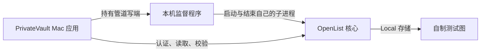

# PrivateVault Owner 协作方式与后续学习路线

版本：v0.1 · 创建：2026-10-29；协作方式更新：2026-10-30

当前约定：**开发期间 Owner 主要理解架构、判断关键决策、验收实际效果。学习路线保留，统一阅读源码安排在用户确认整个项目完成之后。** 单个工作包完成不触发源码阅读任务，开发也不等待阅读进度。架构图、方案取舍与验收说明继续作为当前沟通材料。

AI 负责实现、代码检查与必要测试、问题调查、文档维护，并说明证据与限制。本文保留的文件阅读表、语言知识与练习都是后续参考，不代表当前学习任务，也不代表用户已经掌握或完成。

## 1. 当前 Owner 的三项职责

| 职责 | 当前需要理解或判断的内容 | AI 应提供的材料 |
|---|---|---|
| 理解架构 | 模块各管什么、数据怎么流动、密钥与明文在哪里、哪些功能依赖哪台设备 | 架构图、场景说明、当前能力与未完成边界 |
| 判断关键决策 | 功能优先级、体验/成本/安全取舍，是否接受重要限制 | 选项、推荐方案、理由、影响及必要成本；已确认事项不重复索要确认 |
| 验收实际效果 | 按场景试用，看结果是否符合需求，失败时提示和恢复是否可用 | 可运行结果、操作步骤、预期结果、验证证据及未验证项 |

日常代码实现与技术检查由 AI 推进。当前不要求 Owner 逐段审查源码、讲解函数或完成语言练习；AI 的自动检查结果也不冒充用户亲自验收。

### 统一阅读时的扩展目标（项目完成后）

| 能力 | 对这个项目的具体要求 | 不需要先达到的程度 |
|---|---|---|
| 解释目标 | 说清这阶段解决什么问题、还没有什么能力 | 记住所有功能和字段 |
| 解释数据流 | 从一次点击跟到核心、存储及结果；知道明文和密钥经过哪里 | 从头实现加密算法或驱动 |
| 找到责任模块 | 知道界面、平台桥接、核心适配、任务和资料同步分别在哪里 | 读完每个第三方项目 |
| 判断证据 | 区分代码看起来合理、模拟测试通过、真实核心通过和实际设备可用 | 相信“测试通过”就代表所有需求完成 |
| 管理变更 | 看懂改动范围、关键差异、验收与回退办法，能让 AI 对一个具体问题继续调查 | 手工写完所有代码或审完 SDK 全部源码 |

以下阅读目标及练习留待项目整体完成后统一安排，不作为当前开发或验收的前置条件。

## 2. 保留的 W01-M 阅读主线（后续统一阅读）

点击“启动本机服务” → Dart 的 CoreHost 接口 → Mac 平台桥接 → Swift 核心控制器 → 独立 OpenList 子进程 → 本机认证与 Local 测试目录 → 完整读回测试图 → 状态与测试图返回界面。

媒体不经过另一个 Mac 服务器，W01 也没有连接百度。现阶段只是 PrivateVault 管理自己的本机核心；账号、Crypt、来源下载、任务和跨端同步仍在后面的工作包。

项目整体完成后，可按下面的顺序阅读这一模块；当前只需理解它的架构和验收结果：

| 顺序 | 文件/位置 | 只回答这一个问题 |
|---|---|---|
| 1 | `apps/privatevault/lib/main.dart`、`app.dart` | 应用入口在哪里，CoreHost 从哪里交给界面？ |
| 2 | `lib/core_host/core_host.dart`、`core_state.dart` | 外壳允许调用哪些动作，什么条件才能显示“已就绪”？ |
| 3 | `lib/features/core_status/core_status_page.dart` | 按钮如何发出动作，界面如何接收状态？ |
| 4 | `lib/core_host/macos_core_host.dart`、`macos/Runner/CoreBridge.swift` | Dart 如何跨到 Mac 原生代码，异常为何不直接展示原文？ |
| 5 | `macos/Runner/CoreController.swift` 的 `start`、`launch`、`stop` | 启动经过哪些检查，重复点击和取消如何处理？ |
| 6 | 同文件的 `verifyFixture`、`reconcilePreviousRun` | 为什么“进程存在”还不够，为什么不能只凭 PID 结束进程？ |
| 7 | `test/core_host/`、`test/native/CoreHostSmoke.swift` 和实际验收报告 | 哪些场景被模拟，哪些真的启动核心验证，哪些还没执行？ |

这里的路径以应用目录为基础；正式运行命令与当前执行结果见配套运行说明和验收报告。20—30 分钟的初次源码导读建议也留待整体完成后，不安排在当前开发阶段。

## 3. 项目完成后按模块回顾的学习路线

| 阶段 | 优先学习的知识 | 对应的小练习/理解目标 |
|---|---|---|
| W01 外壳和核心 | Dart 类型、接口、枚举；Future/Stream；子进程、端口、HTTP；Flutter 组件/状态；Swift 桥接的读法 | 能指出启动入口、失败分支和状态更新位置；解释同一进程活着却不能算就绪 |
| W02 库和秘密 | 普通库与 Crypt 的视图、配置完整性、系统秘密存储、信任边界 | 画出密钥和明文出现的位置；解释登录密码、Crypt 密码、恢复包口令各管什么 |
| W03 可靠任务 | 状态机、取消、幂等、重试、超时、SQLite 事务、工作区配额 | 跟踪上传完成但尚未校验时崩溃，该从哪里恢复，为什么不能直接宣布成功 |
| W04 元信息同步 | 记录与查询索引的区别、outbox、版本、冲突、墓碑 | 说明两个设备同时改同一标题时如何保留双方修改；为什么不直接同步数据库文件 |
| W05 浏览播放 | HTTP Range、明文长度、缓存和错误、播放器生命周期 | 说明拖到视频后半段时应请求什么，以及什么证据才支持“没有先下载整个前缀” |
| 来源与账号 | 适配器、上游授权、刷新所有权、限流、外部工具边界 | 跟一次合法来源链接归档，说明凭证在哪里，失效后等待什么 |
| 恢复与迁移 | 一致导出、密钥分离、恢复演练、版本兼容 | 使用自制库说明仅有恢复包能恢复什么、不能恢复什么 |

这份路线只保留为后续统一阅读时的参考。届时读到哪个平台边界，再补对应语言的必要知识；当前不安排完整语言课程或逐阶段源码学习，也不为学习目的增加技术组件。

## 4. 每个工作包的配合方式

实施前：Owner 确认目标、范围、安装/外部影响与接受条件。AI 给出接口和取舍，不能把未知兼容性写成已证实。

交付时：AI 提供可运行结果、架构层面的变化、验收步骤、检查结果和未验证项。Owner 主要试用、比较预期与实际效果，必要时判断取舍；不要求挑选代码文件逐段阅读。

复盘时：先讨论需求有没有满足、体验是否可接受、架构和限制是否需要调整。逐函数复述、定位源码、局部改写和失败测试阅读，统一留到整个项目完成后。

可要求 AI 按下面五点交付：

1. 这一步满足哪条需求，哪些能力仍未完成？
2. 这一步在整体架构中负责什么，数据经过哪里？
3. 改动中最需要理解的两个取舍是什么？
4. 哪些证据来自模拟、真实核心、实际界面/设备？
5. 验收遇到失败时，用户会看到什么，怎样重试、停止或恢复？

## 5. 项目完成后的阅读自查卡（当前不启用）

以下保留未勾选，不形成当前任务或未完成债务；后续统一阅读时再根据用户实际阅读与操作记录：

- [ ] 能用自己的话说明 W01-M 的目标及它还没有实现的业务。
- [ ] 能从按钮找到 CoreHost，再找到 Mac 原生启动逻辑。
- [ ] 能解释 STOPPED、STARTING、READY、STOPPING、FAILED 的区别。
- [ ] 能解释为什么文件存在、HTTP 200、核心进程存在不能各自证明整个功能成功。
- [ ] 能指出日志不应包含哪类秘密，并知道测试资料与真实资料的边界。
- [ ] 能读一项失败测试并说明它防止什么问题。
- [ ] 在环境就绪后亲自运行/观察一次，并区分观察到的结果与尚未验证的部分。

“能复述”“能定位代码”“能做局部修改”“已亲自运行验收”分开记录。项目目标仍以实用为先，学习紧贴已经发生的改动，不另起一个妨碍交付的大课程。

## 6. 第一个真实例子：命令行通过，打包应用却失败

W01-M 的命令行检查已经能运行真实 OpenList，但第一次在 Mac 应用内启动失败。阶段诊断把问题定位到进程文件描述符查询：App Sandbox 拒绝这项查询，读取进程基本身份仍可用。这说明同一份代码在不同运行权限下可能有不同结果。

最终的实例核对结合：固定核心及其摘要、内核提供的 UID/启动时间/可执行路径、本次私有目录中的配置，以及上游现成 JWT 的标准 HS256 签名。应用通过系统 CryptoKit 核验签名与有效期，确认端口上的服务持有本次私有配置密钥；没有关闭沙盒或增加系统权限。当前真实窗口已跑通。

后续强退验收又发现：主应用死亡并不自动结束它直接启动的核心。为此加入 `macos/Helpers/CoreSupervisor.swift`，父应用保留管道写端，监督程序监测读端的 EOF；主应用被强退后，监督程序仍能停止自己保留的核心。这是“进程生命周期”和“资源所有权”在实际项目中的例子。最终 App 强退、核心自动退出和重新打开对账已经通过观察，未把受控清理旧测试实例当成产品恢复通过。

应用退出后，管道读端收到 EOF，监督程序停止核心再退出。图中是当前 Mac 本地开发阶段，没有经过账号服务器或云端媒体。

阅读入口是 `CoreController.swift` 的 `ownsEndpoint`、`verifyLocalToken` 和 `reconcilePreviousRun`，以及 `CoreHostSmoke.swift` 中四个 `jwt_` 检查。先回答：为什么能访问端口还不够？为什么错误密钥、被篡改或过期的令牌必须被拒绝？不需要先手写整套 JWT 或记住系统 API。

这一例子也说明：旧代码的测试通过，不能直接当作修改后代码的证据；模拟检查、命令行真实核心、实际沙盒 App 和用户亲自使用分别记录。
