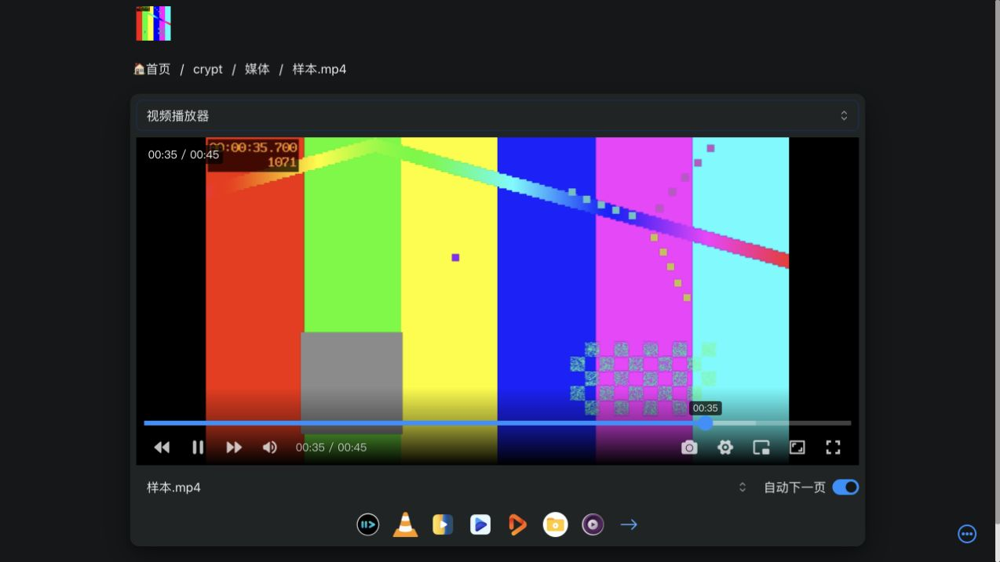

# PrivateVault：Mac 阶段 A 本地验证结果

版本：v0.1 · 日期：2026-10-26（Asia/Shanghai）

状态：**已在用户批准的隔离范围内完成阶段 A。普通/加密读写、本地 Range、浏览器播放和完整重试通过；发现中断上传会留下可见半成品。测试核心已停止，阶段 B 未执行。**

本报告承接[阶段 A 执行方案](../research/04-Mac最小验证方案与官方约束补充-v0.1.md)，不改写已有 v0.1/v0.2 设计历史。结果只覆盖这台 Mac、固定版本核心、自制小样本与本地存储。

## 1. 对架构的结论

可以继续验证“各设备运行本地 OpenList，普通库直通、加密库经过 Crypt，UI 通过本地服务浏览和播放”的方向。本机已实际走通该基础链路。

**目前不能把 OpenList 文件存在、目录列举成功或 HTTP 200 当作 PrivateVault 的归档成功条件。** 本轮中断的文件在重启后仍可列举和下载，但只有原视频的一小部分。可靠归档必须另有暂存、预期长度/完整性核对、完成后提交和重启对账机制。

百度上传、云端高效 Range、Android/Windows 独立性、跨端 Crypt 互读和来源下载仍待验证。本轮结果不构成整个产品可行性已确认，也未授权开始业务实现。

## 2. 实际执行范围

- 另行下载官方固定发行包，核对摘要、归档范围、签名和版本；没有使用现有 Desktop 内的核心或 rclone。
- 在新的临时目录生成样本、配置、数据库、密钥与验证辅助工具；没有安装系统工具、注册常驻服务或编写 PrivateVault 实现代码。
- 仅建立两个 Local 存储和一个 Crypt 视图，没有百度或来源站挂载。
- 核心只监听 `127.0.0.1:15244`；独立进程策略限制外联和工作区外写入。未修改系统网络或安全设置。
- 浏览器访问这个临时实例，完成普通与加密样本预览；没有打开用户原有 OpenList 管理界面。
- 只停止、重启本次核心一次用于中断验证，结束时再次停止；没有读取、复制或修改原应用的配置、数据库、日志、百度凭证和媒体。

官方工具下载涉及 GitHub/CDN 网络；样本处理与播放均为本地链路。这里没有真实云端流量观测。

## 3. 工具、配置与样本

### 3.1 固定工具

| 项目 | 实际值 |
|---|---|
| 官方发行 | [OpenList v4.2.8](https://github.com/OpenListTeam/OpenList/releases/tag/v4.2.8) |
| 发行文件 | `openlist-darwin-arm64.tar.gz`，51,573,965 字节 |
| SHA-256 | `c845f509d784a936ce53610c5643cedd05223e42ceb63fce5ad1bacbca1bbcd7`，与事先固定值相符 |
| 核心版本/提交 | v4.2.8 / `25e4eb6` |
| 运行时/网页版本 | Go 1.27.3 darwin/arm64 / WebVersion v4.2.8 |
| 构建时间 | 2026-10-24 10:40:47 UTC |
| 新核心严格签名验证 | 通过，返回码 0 |

新核心通过不改变此前现有 Desktop 严格签名未通过的记录，也不解释其原因。没有修复或更新现有应用。摘要与签名验证不是完整代码安全审计。

### 3.2 测试存储

| 挂载 | 驱动 | 内容 |
|---|---|---|
| `/plain` | Local | 普通样本及中断用目标 |
| `/cipher-raw` | Local | 仅存放本轮生成的密文 |
| `/crypt` | Crypt | 对 `/cipher-raw` 的解密视图 |

Crypt 实际采用：标准文件名加密、目录名加密开启、base32 文件名编码，密码和 salt 都为新生成的测试值。未复用真实收藏库密钥。这组参数是验证配置，不自动成为正式库默认值。

为了只读预览自制文件，临时实例允许访客读取测试挂载并关闭全局下载签名；范围限于环回实例。这个测试配置不能直接照搬为产品的访问控制方案。

### 3.3 自制样本

| 样本 | 大小（字节） | 内容/格式 |
|---|---:|---|
| PNG | 9,763 | 256×256 技术测试图 |
| WAV | 960,078 | 10 秒、48kHz PCM，静音 |
| MP4 | 44,852,235 | 45 秒、640×360 H.264/AAC，画面带计时，音轨静音 |
| 合计 | 45,822,076 | 约 43.7MiB，低于约定的 100MiB |

由本机已有 FFmpeg 生成，未扫描或读取个人媒体。样本摘要、媒体探测数据及全部脱敏结果见 [evidence.json](stage-a-20261026/evidence.json)。

## 4. 验收对照

| 编号 | 实际结果 | 判定与边界 |
|---|---|---|
| A01 工具核对 | 官方包摘要、归档范围、核心严格签名、版本核对通过 | 通过；未运行原 Desktop 附带工具 |
| A02 隔离启动 | 仅本机 15244 监听；额外服务关闭；启动与重启后均只有 Local/Local/Crypt | 通过；无云盘挂载 |
| A03 普通读写 | 三类样本上传后完整读回，长度及 SHA-256 全部一致 | 3/3 通过 |
| A04 Crypt 读写 | 三类样本加密上传、解密完整读回，长度及 SHA-256 全部一致 | 3/3 通过；独立 rclone 互读未测 |
| A05 Range | 普通/加密视频各 7 项，返回范围与原始字节逐一比较 | 14/14 通过；仅本地后端 |
| A06 预览播放 | 普通/加密 PNG 正常显示，WAV 进度推进，MP4 播放与跳转成功 | 本轮格式通过；静音样本不验收音质或声卡输出 |
| A07 中断/恢复 | 一次普通视频上传中断；半成品重启后可见；全量重试摘要一致 | 完整重试通过，发现归档完整性缺口；不证明字节续传 |
| A08 记录/退出 | 脱敏证据与截图落盘；结束时核心正常退出、端口释放 | 通过；临时目录保留，未执行云端清理 |

### 4.1 完整读回与密文观察

六次完整读回均为 HTTP 200，长度和 SHA-256 与对应源样本相符。Crypt 目录产生三个密文文件，均具有 `RCLONE` 格式头，未直接显示本轮的明文文件名与目录名。

这是本次配置下的格式与读回证据，不是密码学审计，也不证明所有元信息、访问时间或文件大小均被隐藏。

### 4.2 Range 实际检查

普通与加密视频均检查了：

1. 首部 `0–65535`；
2. 跨 64KiB 明文块边界 `65535–65536`；
3. 中段 32KiB；
4. 末尾 64KiB；
5. 后缀范围最后 500 字节；
6. 开放结束范围最后 500 字节；
7. 超出总长的非法范围。

前六项均为 HTTP 206，`Content-Range`、长度与返回字节正确；非法范围均为 HTTP 416，返回正确总长 44,852,235。

这里直接测试 `/d` 下载路径；浏览器预览实际使用同实例的 `/p` 路径。没有以本机毫秒级读取时间推断云盘性能，没有测百度上游传输量、冷缓存拖动或完整前缀回退。

### 4.3 实际浏览器播放

浏览器：Mac 上的 ChatGPT 内置浏览器；使用发行包内 OpenList 页面及内置播放器，未调用外部播放器。

| 模式 | 图片 | 音频 | 视频 |
|---|---|---|---|
| 普通 | 自然尺寸 256×256，成功加载 | 页面计时由 00:00 推进到 00:08 / 00:10 | 播放到约 8.10 秒，点击进度条跳至约 35.73 秒，随后至 45 秒结束 |
| Crypt | 自然尺寸 256×256，成功加载 | 页面计时由 00:00 推进到 00:06 / 00:10 | 播放到约 11.15 秒，跳至约 35.74 秒，随后至 45 秒结束 |

两个视频解码尺寸均为 640×360，观测时 `readyState=4`，没有媒体错误。音频证据来自可见播放器进度；本轮没有取得该播放器未挂入 DOM 的音频对象状态，不将 UI 计时扩写为音频输出质量证明。

截图：[普通图片](stage-a-20261026/browser-plain-image.png)、[普通音频](stage-a-20261026/browser-plain-audio.png)、[普通视频](stage-a-20261026/browser-plain-video.png)、[加密图片](stage-a-20261026/browser-crypt-image.png)、[加密音频](stage-a-20261026/browser-crypt-audio.png)、[加密视频](stage-a-20261026/browser-crypt-video.png)。

## 5. 关键发现：半成品会被当作普通文件暴露

受控流程为：向 `/plain/interrupted.mp4` 缓慢上传 44,852,235 字节视频，达到预定中断点后只停止本次核心，然后重新启动并检查原目标。

实际观察：

| 项目 | 结果 |
|---|---|
| 客户端已发送 | 2,752,512 字节 |
| 上传是否成功返回 | 否，连接中断为 `BrokenPipeError` |
| 磁盘残留 | 2,686,976 字节，约 2.56MiB |
| 重启后的目录列举 | 原目标名可见，显示为上述残留长度 |
| 读取残留文件 | HTTP 200，内容只有残留部分 |
| 完整重新上传后 | 44,852,235 字节，SHA-256 与原视频一致 |
| 原加密视频重启后 | 完整读回摘要仍一致 |

这不是“恢复了上次已上传字节”。本轮执行的是**全量重新上传**，没有证明持久化上传检查点或自动任务恢复。

建议后续在产品设计中落实以下要求，当前尚未实现：

- 上传目标先进入任务专属暂存区，不直接纳入媒体索引；只有核对预期长度与完整性后才提交归档完成状态。
- 记录源样本身份、预期长度/摘要、暂存对象、目标对象和任务阶段；重启后以这些记录对账，而非“目录里已经有文件”就跳过。
- 本地后端可评估同文件系统重命名提交；云盘重命名、覆盖和可见性语义必须另测，不假定等同本地原子操作。
- 已存在但不完整的目标进入待恢复/冲突处理；不得误覆盖用户原件或把重试当作新成功资料。
- 所有暂存文件计入空间预算，清理行为与用户的默认不删云端策略分开约束。

该现象来自 Local 普通上传的一次受控停止，不能据此断言 Crypt/百度的中断行为相同；后者仍需专门验证。

## 6. 空间、秘密与退出

基础检查后工作区文件大小合计约 464.3MiB；功能验证结束时约 595.4MiB，均低于约定的 2GiB 操作预算。末次系统剩余空间约 237.1GiB，高于 15GiB 保留下限。

这些是文件逻辑大小的离散观测值，不是连续监测的真实峰值、实际磁盘块占用或内核强制配额。不能据此验收大文件/并发任务的空间控制、内存性能或 6TB 媒体库规模。

临时根目录为当前用户可访问的 0700，测试秘密与 API 状态文件为 0600。项目内只保存已筛选证据和自制样本截图，不保存管理密码、Crypt 密钥、登录令牌、数据库或原始控制台日志。0700/0600 是本机权限限制，不等于磁盘加密，也不是正式密钥托管方案。

最终测试核心退出码为 0；端口 15244 查询未见监听；测试浏览器标签已关闭。未设置开机自启、未留下运行中的本次核心。

临时工作区 `/private/tmp/privatevault-validation-20261026-Da3beZ` 按已批准方案保留供审阅，其中含测试恢复材料；未删除用户原文件或云端对象，也未提交 Git。此目录由系统临时空间管理，不作为长期备份；清理范围另行确认。

## 7. 执行过程中的问题及其归属

- 官方下载遇到超时和限速，使用同一官方文件的分段/续取取得完整包，最终摘要与固定值一致。没有换镜像、版本或来源。该过程不证明 PrivateVault 下载队列已实现。
- 临时进程隔离规则最初使用的环回地址语法被系统拒绝；改成支持的本机端口表达后预检通过，核心实际监听仍为 `127.0.0.1`。没有移除系统保护。
- 上轮自动审批因额度用尽未能完成，挂载设置当时没有执行。用户要求继续后重新通过审批才执行，未绕过审批。

以上属于工具获取、临时验证环境及执行服务的问题，不归类为 PrivateVault 产品缺陷。中断半成品行为则是本轮实际发现的底层语义，需要产品处理。

## 8. 下一阶段与仍未验证的项目

下一步应先收敛**阶段 B 的百度授权方式及隔离云端测试方案**，再请求具体执行批准。本轮不自动开始阶段 B。

| 待办 | 为什么仍需验证 |
|---|---|
| 现有百度挂载的授权方式 | 用户确认可用，但方式不确定；本轮没有查看设置或凭证 |
| 单次 refresh token 的刷新所有权 | 不能把既有刷新链无协调复制到第二实例 |
| 应用身份、允许目录、权限与配额 | 新测试应用不自动继承现有挂载能力 |
| 百度普通/加密上传及完整读回 | 本轮底层是 Local，不是百度驱动 |
| 云端冷缓存 Range 与拖动流量 | 本地 206 和播放成功不能代替上游效率证据 |
| 百度/加密上传中断、空间峰值 | 本轮未触发云端完整密文暂存、上传会话或限额 |
| Windows、Android 与 Mac 睡眠独立播放 | 没有运行相应设备，本机测试不证明其生命周期或凭证独立性 |
| 独立 rclone 及跨客户端 Crypt 互读 | 本轮加解密都由同一个固定版本 OpenList 完成 |
| Pixiv、hanime1、账号与元信息同步、离线收藏 | 未连接来源站，也未实现相应模块 |

本轮没有新增产品偏好问题。第 5 节的可靠归档要求与阶段 B 授权方案需在后续设计/验证中明确；最终产品选型仍应等待这些证据闭合。
