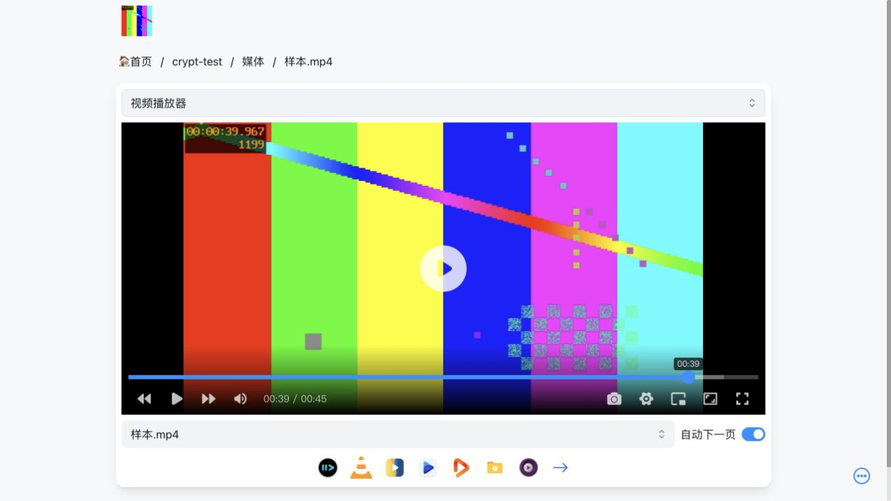

# PrivateVault：B2 音视频播放与 Range 验证结果

版本：v0.1 · 归档日期：2026-10-28（Asia/Shanghai） · 执行跨 2026-10-27—28

状态：**Mac 上普通/Crypt 音视频的百度上传、完整读回、页面播放和正常视频范围读取通过。严格 Range 验收为 13/14：普通视频的越界请求返回 400，未达到预期 416。** 此差异保留为待处理项，不写成 B2 全项通过。测试服务已关闭，云端 6 个媒体对象保留；未开始 PrivateVault 产品实现。

执行范围见[提案 12](12-B2音视频与云端Range验证范围-v0.1.md)，图片前置结果见[报告 11](11-B1续测结果-普通与加密图片通过-v0.1.md)。本报告仅增加当前 Mac、固定 OpenList、测试授权和自制样本的实际证据，不改变 v0.1/v0.2 设计历史。

## 1. 结论与适用范围

本轮支持继续采用 OpenList 核心处理“百度存储＋可选 Crypt＋本机媒体服务”的候选架构。在这段约 42.8MiB 的视频上，中段与尾段读取没有出现先下载整个文件前缀的流量特征；加密视频可以解密播放，并定位到相符的实际画面。

同时保留两个产品接入要求：普通路径需要统一越界 Range 的响应，错误页需要隐藏上游链接及查询参数。本轮只记录行为和源码依据，没有修改核心、切换存储设置或编写产品修复。

| 项目 | 实际范围 |
|---|---|
| 核心 | 官方 OpenList v4.2.8 arm64，沿用阶段 A 已核对文件 |
| 授权 | 沿用路线 B 的测试授权及唯一百度驱动，不重新授权、不导入旧接收种子 |
| 云端根 | `/PrivateVault-验证-20261027/`，只操作既有测试子树 |
| 下载方式 | `official`；普通与 Crypt 存储记录的 `proxy_range` 均为 false |
| 加密 | 沿用 B1 测试 profile：标准名称加密、目录加密、base32 名称编码 |
| 本机服务 | 核心仅 `127.0.0.1:15245`，TLS 转发器仅 `127.0.0.1:15246` |
| 浏览器 | macOS 上的 ChatGPT 内置浏览器，独立测试标签页；窄窗口截图不代表 Android |
| 内容 | 自制静音 WAV 和带时间码的 MP4，没有读取个人媒体或来源站 |

本轮没有验证 Windows、Android、独立 rclone 客户端互读、Mac 睡眠后的跨端独立性、长视频/其他编码、来源下载、后台播放、账号同步、凭证到期或可靠归档任务。

## 2. 上传与完整读回

普通与 Crypt 各追加 WAV、MP4 一份，共 4 个对象。每个对象仅执行一次应用级上传，没有覆盖 B1 图片或重复上传；驱动内部尝试不能与应用级次数等同。

| 样本 | 明文大小 | 格式 | 普通读回 | Crypt 解密读回 |
|---|---:|---|---|---|
| WAV | 960,078 字节 | 10 秒，48kHz PCM，静音 | HTTP 200，长度及 SHA-256 一致 | HTTP 200，长度及 SHA-256 一致 |
| MP4 | 44,852,235 字节 | 45 秒，640×360，H.264/AAC，静音音轨 | HTTP 200，长度及 SHA-256 一致 | HTTP 200，长度及 SHA-256 一致 |

原样本与两种完整读回的摘要：

- WAV：`d9f19abdb1241a1d55108f7c8c45ab7bfa2452b59e2427dfb1b5dac94beff1e5`
- MP4：`cd5603de378fa45fe453ca8bec0ffe940425d97c2aefabaea7b279b90be3c1cd`

云端 WAV 密文为 960,350 字节，MP4 密文为 44,863,227 字节；加密目录及文件名称仍为密文。完整性结论来自读回响应体比对，不来自列表、HTTP 200 或上传进度。

## 3. 范围正确性与冷启动读取成本

普通/Crypt 视频各 7 项，共 14 个不同用例。**12 项正常范围全部返回 206，范围头、长度和每个响应字节与源文件对应区间一致。** Crypt 越界响应也符合要求；普通越界响应不符合要求。

| 请求 | 普通 | Crypt |
|---|---|---|
| 首部 64KiB | 206，通过 | 206，通过 |
| 跨块 2 字节：65535—65536 | 206，通过 | 206，通过 |
| 中段 64KiB | 206，通过 | 206，通过 |
| 尾段 64KiB | 206，通过 | 206，通过 |
| 最后 500 字节后缀 | 206，通过 | 206，通过 |
| 距结尾 500 字节的开放结束范围 | 206，通过 | 206，通过 |
| 起点超过文件长度 | **400，无 Content-Range，未通过** | 416，`bytes */44852235`，通过 |

首部、中段、尾段和跨块共 8 项，各自使用新核心进程及新的空 TempDir，且进程此前没有读取视频内容。其余用例不是独立冷启动。完整读回文件没有作为本地存储挂载来响应这些请求。

“冷”只针对本轮核心及临时目录；没有清除百度/CDN 缓存，也不声称清空操作系统所有缓存。

### 3.1 中段和尾段的观测值

| 链路/区间 | 下游响应体 | 来自上游的入站增量 | 请求完成耗时 |
|---|---:|---:|---:|
| 普通中段 | 65,536 字节 | 82,800 字节 | 3.3807 秒 |
| 普通尾段 | 65,536 字节 | 82,834 字节 | 3.2141 秒 |
| Crypt 中段 | 65,536 字节 | 151,606 字节 | 6.4424 秒 |
| Crypt 尾段 | 65,536 字节 | 111,625 字节 | 5.5934 秒 |

入站增量是 TLS 转发器计数差，包含 TLS 和必要元信息，不是精确媒体载荷。完成耗时是范围请求的观测值，不是点击播放器后稳定显示画面的延迟。

所有正常用例的入站增量均小于 1MiB，未触发每试次 8MiB 安全上限。这支持当前样本/配置没有读取完整前缀；不能外推 6TB 库、大视频、移动弱网或“秒开”。加密中段一次观测约 6.4 秒，也说明仍需在真实使用条件下评估体验。

Crypt 跨块请求只返回 2 字节，但上游入站约 151,645 字节。读取和认证需要按加密块对齐，不能把极短明文请求的云端成本等同于 2 字节。

### 3.2 普通越界请求：保留的失败项

预期：HTTP 416，并提供 `Content-Range: bytes */44852235`。

实际：HTTP 400，无 Content-Range；百度错误码 31023，消息 `param error , http_range`。该项不属于成功读取，也没有当作鉴权、配额或内容完整性失败。初次断言失败后保留停点，再作一次只读诊断以确认错误类型；未重传文件、重新授权或修改错误处理，随后继续独立的 Crypt 与页面检查。

错误正文包含上游 URL 及查询参数。原始正文留在私有临时区，项目仅导出状态、错误码及“存在链接/参数”的布尔结论，不导出原始 URL、参数值或请求标识。

固定核心源码提供了两种路径的解释依据：[代理选择](https://github.com/OpenListTeam/OpenList/blob/25e4eb663ffb73991a68d85df4f690d48ad137a6/server/common/proxy.go)中，有 RangeReader 时使用本机范围响应，另一分支透传上游请求；[本机范围服务](https://github.com/OpenListTeam/OpenList/blob/25e4eb663ffb73991a68d85df4f690d48ad137a6/internal/net/serve.go)负责相应范围逻辑。核对的 blob 分别为 `cc3ea8bb655b0d70790991acda3ff1cf673b3226`、`53604c3ecd606554e1c8579a2063e7443473ca4b`。源码解释与实际响应分别记录，不把它扩写为所有版本/驱动的行为保证。

后续本机媒体适配层应在已知明文长度时统一越界 Range 为 416，并屏蔽错误正文中的上游地址及敏感字段。也可单独评估现有 `proxy_range` 设置，但本轮没有切换或验证它，不能认定它已经解决问题。

## 4. 页面音视频与实际画面

两种音频均观察到播放进度推进：普通 `00:00 → 00:09 / 00:10`，Crypt `00:00 → 00:04 / 00:10`。样本静音，只证明读取、解码和进度，不能证明声音输出、ASMR 音质、蓝牙、后台或锁屏能力。

普通与 Crypt 视频均识别为 45 秒、640×360，无媒体错误；中段定位后可继续播放至结尾，尾段再次播放后时间继续推进：

| 观察 | 普通 | Crypt |
|---|---|---|
| 中段定位 | 约 21.9077 秒 | 约 22.2235 秒 |
| 尾段恢复的连续采样 | 40.051788 → 40.137125 秒 | 40.077749 → 40.103620 秒 |
| 恢复状态 | paused=false，readyState=4 | paused=false，readyState=4 |

视频读取路径为本机核心 `/p/…`，浏览器测试没有接收百度或 Crypt 密钥。页面播放没有作为独立的冷缓存浏览器测试；其流畅程度不能替代第 3 节范围接口的冷启动数据。

### 4.1 加密视频的稳定画面补证

一张紧接定位操作的截图仍呈现先前画面，不能仅凭 currentTime 已改变就接受新帧。因此追加一次只读页面复核，没有上传：暂停定位，再在后续独立截图中检查画面内嵌时间码。

| 位置 | 页面媒体时间 | 实际画面时间码 | 留证 |
|---|---:|---|---|
| 中段 | 21.9981 秒 | `00:00:21.967` | [稳定中段](b2-20261028/crypt-video-middle-stable.jpg) |
| 尾段 | 39.9981 秒 | `00:00:39.967` | [稳定尾段](b2-20261028/crypt-video-tail-stable.jpg) |

两张稳定画面的时间码与目标位置相符。即时截图不作为帧正确性的主证据；本轮没有测得精确的定位到稳定画面延迟，也不将即时捕获现象认定为已定位的播放器缺陷。



其他证据：[普通音频](b2-20261028/plain-audio.jpg)、[加密音频](b2-20261028/crypt-audio.jpg)、[普通视频尾段暂停](b2-20261028/plain-video-tail.jpg)、[普通视频尾段恢复播放](b2-20261028/plain-video-tail-playing.jpg)。原始截图字节为 JPEG，已据实际格式纠正初始后缀，没有重新编码或修改像素。尺寸与 SHA-256 记录在证据清单中。

## 5. 云端保留、资源与退出

云端清单含普通/密文 PNG、WAV、MP4 各一份，共 6 个媒体对象，总对象大小 91,655,464 字节。本轮 B2 新增的 4 个对象合计 91,635,890 字节，约 87.4MiB；对象大小不是网络流量。没有覆盖或删除云端对象。

| 资源 | 最终记录 | 边界 |
|---|---:|---|
| B2 TLS 隧道上行 | 92,184,050 字节 | 包含所有 B2 重启与最后只读画面复核 |
| B2 TLS 隧道下行 | 186,727,802 字节 | 含 TLS、元信息、完整读回、范围和页面读取 |
| 合计 | 278,911,852 字节，约 266.0MiB | 低于 512MiB 预算；不含 DNS、环回和 TCP/IP 头 |
| 工作区最终逻辑大小 | 289,028,899 字节，约 275.6MiB | 本次保留采样中的最大值，低于 2GiB 操作预算 |
| 系统最终可用空间 | 254,361,600,000 字节，约 236.9GiB | 高于 15GiB 保留下限 |

这些是离散计数/快照，不是完整网络线上字节、连续磁盘峰值或内核配额保证。最终文件快照之后的小型证据写入会使逻辑大小略有变化；没有据此声称已解决大文件暂存峰值。

收尾检查：核心和转发器退出码均为 0，端口 15245/15246 未见监听；两张专用测试标签页已关闭，原授权页未查看。没有新增开机常驻。

最新测试提供者状态及 Crypt 参数保留在 0700 私有临时工作区：

```text
/private/tmp/privatevault-b1-validation-20261027-6b1t9fv3
```

当前状态已由工具内部另行保存；刷新值未较原始种子改变。此事实不证明刷新轮换或到期恢复已通过。旧种子仍标为仅接收记录，不应重新导入覆盖当前状态。临时目录不是长期恢复材料备份。

没有读取/修改用户原 OpenList 配置、数据库、凭证或正式收藏；原挂载当前登录状态未验证，不能声称新旧授权链已经证实互不影响。没有安装新软件、部署产品、提交或推送 Git。

## 6. 对后续设计的影响与下一门槛

| 设计项 | 本轮后的状态 |
|---|---|
| Mac 百度普通/Crypt 音视频完整性 | 当前样本通过 |
| 当前视频正常范围读取及有限成本 | 12 项通过，8 项核心冷启动；保留样本/网络限制 |
| Range 错误响应 | 普通越界 400 待统一为 416，不能标记完整协议验收通过 |
| 错误信息保护 | 原始上游 URL 不应进入产品错误页或普通日志 |
| Web UI 与独立解密 | 本轮页面依赖 Mac 本地核心；不能代替其他设备的独立核心 |
| 任务可靠性 | 阶段 A 的半成品风险仍成立；本轮没有实现提交校验、恢复状态机 |
| 大文件与移动体验 | 暂存峰值、其他编码、弱网、后台及锁屏仍待实测 |

下一项建议是 **Windows/Android 独立核心与 Crypt 互读的验证准备**：先确认设备与现有应用状态、版本及安全配置迁移方式，再形成各设备的有限操作范围。真正验收应包含各端本机加密上传/解密播放，以及 Mac 休眠/账号服务停止后的独立运行；还要明确刷新凭证的唯一协调方式，避免同时启动复制同一旧令牌的多个刷新者。

这只是下一门槛的建议。本轮在证据归档后结束，不自动安装手机/Windows 软件、复制测试凭证、启动下一轮云测或进入业务实现。来源适配、元信息同步、离线能力及账号服务仍保留各自的设计与验收门槛。

## 7. 可审阅证据

[B2 脱敏 evidence.json](b2-20261028/evidence.json)包括样本摘要、4 份完整读回、云端对象清单、14 项范围结果、8 项冷启动标记、普通越界的筛选结论、浏览器媒体状态、稳定画面时间码、资源采样、累计计数、截图摘要和退出恢复状态。

导出采用文件白名单，并内部比对测试秘密及常见编码形式；没有复制私有配置、数据库、原始错误正文、原始页面快照、真实下载 URL 或凭证值。6 张截图经目视检查且按原字节保存。首次 DNS 失败、B1 续测和 B2 的越界失败记录各自保留，没有用后续成功覆盖历史。
